# docs-kampus

Documentación de **Kampus**: aplicación para la integración social de estudiantes universitarios de la UTT, la UAdeC y el Tecnológico de la Laguna. Equipo 9A · Desarrollo Web Integral.

**Sitio publicado:** https://doc.kodev.online/

> [!NOTE]
> Este README contiene **completos** el documento de la **Unidad 1** (anteproyecto) y la documentación de la **Unidad 2**, para leerlos directamente en GitHub sin entrar al sitio. Es el mismo contenido que la sección **Proyecto** del sitio. Los diagramas se dibujan aquí mismo y las imágenes están en `public/docs/project/`.

## Índice

- [Proyecto](#proyecto)
  - [El proyecto](#el-proyecto)
  - [Privacidad de la ubicación](#privacidad-de-la-ubicación)
- [Unidad 1 · Anteproyecto](#unidad-1--anteproyecto)
  - [Anteproyecto](#anteproyecto)
  - [Problemática y justificación](#problemática-y-justificación)
  - [Objetivos](#objetivos)
  - [Alcance y limitaciones](#alcance-y-limitaciones)
  - [Análisis de riesgos](#análisis-de-riesgos)
  - [Requisitos](#requisitos)
  - [Metodología y roles](#metodología-y-roles)
  - [Separación en tareas](#separación-en-tareas)
  - [Cronograma](#cronograma)
  - [Arquitectura y tecnologías](#arquitectura-y-tecnologías)
  - [Patrones de diseño](#patrones-de-diseño)
  - [Wireframes](#wireframes)
  - [Definición de contenido](#definición-de-contenido)
- [Unidad 2 · Versionamiento y diseño](#unidad-2--versionamiento-y-diseño)
  - [Rúbrica y avance](#rúbrica-y-avance)
  - [Guion de la revisión](#guion-de-la-revisión)
  - [Control de versiones](#control-de-versiones)
  - [Flujo de trabajo](#flujo-de-trabajo)
  - [Configuración de los repositorios](#configuración-de-los-repositorios)
  - [Repositorios y evidencias](#repositorios-y-evidencias)
  - [Diagramas del sistema](#diagramas-del-sistema)
  - [Diccionario de datos](#diccionario-de-datos)
  - [Prototipo y maquetado](#prototipo-y-maquetado)
- [Sitio de documentación](#sitio-de-documentación)

## Proyecto

*Documentación formal de Kampus para la asignatura Desarrollo Web Integral.*

**Aplicación para la integración social de estudiantes universitarios.**

*Alcance: Universidad Tecnológica de Torreón (UTT) · Universidad Autónoma de Coahuila (UAdeC) · Tecnológico de la Laguna*

| Dato | Valor |
| --- | --- |
| Programa educativo | Ingeniería en Desarrollo y Gestión de Software |
| Asignatura | Desarrollo Web Integral |
| Grupo | 9A |
| Profesor | Jesús Del Toro Robledo |

### Equipo

| Integrante | Rol Scrum | Área |
| --- | --- | --- |
| Jorge Alejandro Rentería Reyes | Product Owner | Documentación |
| Wilbert Omar Acosta Barrera | Scrum Master (propuesto) / Desarrollador backend | Backend |
| Mario Humberto García Rodríguez | Desarrollador backend | Backend |
| Luis Carlos Fernández Quiñones | Desarrollador frontend | Frontend |
| Marcelo Alessandro Sifuentes de la Cruz | Desarrollador frontend | Frontend |

### Contenido

- **[El proyecto](#el-proyecto)**: Qué es Kampus, a quién va dirigido y con qué está construido.
- **[Privacidad de la ubicación](#privacidad-de-la-ubicación)**: Reglas obligatorias para el manejo de datos de ubicación (RNF-11).
- **[Unidad 1 · Anteproyecto](#anteproyecto)**: Problemática, objetivos, alcance, riesgos, requisitos, metodología, cronograma, arquitectura y diseño.
- **[Unidad 2 · Versionamiento y diseño](#rúbrica-y-avance)**: Control de versiones, flujo de trabajo, diagramas, diccionario de datos y prototipo.

### Repositorios

| Repositorio | Contenido |
| --- | --- |
| [`backend-kampus`](https://github.com/WilbertDevMx/backend-kampus) | API REST en Laravel |
| [`Frontend-Kampus`](https://github.com/reyes200205/Frontend-Kampus) | App en Expo (web y móvil) |
| [`Docs-Kampus`](https://github.com/reyes200205/Docs-Kampus) | Este sitio de documentación |

### El proyecto

*Qué es Kampus, a quién va dirigido y con qué está construido.*

#### Qué es Kampus

Kampus ayuda a estudiantes universitarios de La Laguna a conocerse e integrarse: descubrir a otras personas, hacer *match*, chatear, hacer videollamadas y encontrar gente **cerca de ti** sin exponer su ubicación exacta.

#### Instituciones

El registro solo acepta correos institucionales (RF-01):

| Institución | Dominio |
| --- | --- |
| Universidad Tecnológica de Torreón (UTT) | `utt.edu.mx` |
| Universidad Autónoma de Coahuila (UAdeC) | `uadec.edu.mx` |
| Tecnológico de la Laguna | Pendiente de confirmar |

> [!WARNING]
> **Dominio del Tecnológico de la Laguna**
>
> El backend acepta `correo.itlalaguna.edu.mx` (variable `KAMPUS_ALLOWED_EMAIL_DOMAINS`) y la app valida `lalaguna.tecnm.mx` (`src/constants/auth.ts`). Hay que confirmar el dominio correcto y usar el mismo en ambos proyectos.

#### Arquitectura

El proyecto se divide en dos aplicaciones independientes, cada una en su repositorio:

- **Backend**: API REST en Laravel que concentra los datos, la autenticación y la lógica. Ver [Backend](https://doc.kodev.online/docs/backend).
- **App**: aplicación en Expo (React Native Web) que consume la API; se publica en web y a futuro en iOS y Android. Ver [App (Expo)](https://doc.kodev.online/docs/mobile).

#### Stack

| Capa | Tecnología |
| --- | --- |
| API | Laravel 13 (PHP 8.3) |
| Autenticación | Laravel Sanctum (tokens) |
| Base de datos | PostgreSQL 16 |
| Tiempo real | Laravel Reverb + Echo (chat y notificaciones de match) |
| Archivos | Bucket compatible con S3 (Cloudflare R2 / MinIO) |
| Videollamada | LiveKit, detrás de una interfaz `VideoCallProvider` |
| App | Expo SDK 57, React Native, Expo Router |
| Documentación | Fumadocs (Next.js), publicada en Cloudflare |

### Privacidad de la ubicación

*Reglas obligatorias para el manejo de datos de ubicación (RNF-11).*

Kampus maneja datos de ubicación para la vista **Cerca de ti**. Estas reglas aplican a todo el código, tanto en el backend como en la app.

> [!CAUTION]
> **Regla principal**
>
> **Nunca** se guarda la coordenada exacta de un usuario para el mapa.

#### Qué se puede guardar

- La **zona declarada** por el usuario (campus o colonia).
- Una **celda aproximada de ~1 km**: un geohash de precisión 6.

#### Ubicación exacta

La ubicación exacta solo viaja dentro de un **mensaje de chat** que el emisor autorizó explícitamente. No se almacena fuera de ese mensaje.

#### Borrado

Al desactivar **Cerca de ti** o eliminar la cuenta, los datos de ubicación se borran.

#### Por qué PostgreSQL

La vista **Cerca** trabaja con datos geográficos; por eso el backend usa PostgreSQL. Ver [Instalación del backend](https://doc.kodev.online/docs/backend/installation).

## Unidad 1 · Anteproyecto

### Anteproyecto

*Documento de la Unidad 1: el planteamiento completo de Kampus.*

El anteproyecto define qué problema resuelve Kampus, qué se va a construir, cómo se organiza el equipo y con qué tecnologías. Cada sección del documento original es una página:

| # | Sección | Página |
| --- | --- | --- |
| 1–2 | Problemática y justificación | [Problemática](#problemática-y-justificación) |
| 3–4 | Objetivo general y específicos | [Objetivos](#objetivos) |
| 5–6 | Alcance, MVP y limitaciones | [Alcance y limitaciones](#alcance-y-limitaciones) |
| 7 | Análisis de riesgos | [Riesgos](#análisis-de-riesgos) |
| 8 | Requisitos e historias de usuario | [Requisitos](#requisitos) |
| 9 | Scrum, roles y plan de contingencia | [Metodología](#metodología-y-roles) |
| 10 | Separación en tareas | [Tareas](#separación-en-tareas) |
| 11 | Cronograma por sprint | [Cronograma](#cronograma) |
| 12 | Arquitectura y tecnologías | [Arquitectura](#arquitectura-y-tecnologías) |
| 13 | Patrones de diseño | [Patrones de diseño](#patrones-de-diseño) |
| 14 | Wireframes | [Wireframes](#wireframes) |
| 15 | Definición de contenido | [Contenido](#definición-de-contenido) |

> [!NOTE]
> **Cambio respecto al documento entregado**
>
> El anteproyecto planteaba el frontend como una SPA en React + Vite. El equipo lo construye con **Expo (React Native Web)**: hoy se publica como aplicación web y la misma base de código podrá compilarse para iOS y Android más adelante. La página de [Arquitectura](#arquitectura-y-tecnologías) ya refleja este cambio.

> [!WARNING]
> **Nuevo · Sprint 2: Módulo de Administración**
>
> El 19 de octubre de 2026 el Product Owner y el profesor aprobaron agregar un **Módulo de Administración**: moderadores por universidad, administradores, aprobación de grupos y una bitácora de moderación. Lo nuevo va marcado con **[Nuevo]** en cada página y en amarillo en los diagramas. Páginas actualizadas: [Objetivos](#objetivos), [Alcance](#alcance-y-limitaciones), [Riesgos](#análisis-de-riesgos), [Requisitos](#requisitos), [Metodología](#94-cambios-de-alcance), [Tareas](#separación-en-tareas), [Cronograma](#cronograma), [Arquitectura](#arquitectura-y-tecnologías) y [Wireframes](#wireframes); en la Unidad 2, [Diagramas](#diagramas-del-sistema), [Diccionario de datos](#diccionario-de-datos) y [Prototipo](#prototipo-y-maquetado).

### Problemática y justificación

*Por qué Kampus: el aislamiento de los estudiantes de nuevo ingreso.*

#### 1. Problemática

El ingreso a la educación superior representa para muchos estudiantes un cambio significativo en su entorno social, ya que deben adaptarse a una nueva institución, a nuevos compañeros y, en muchos casos, a una nueva ciudad. Este proceso de adaptación suele ser especialmente complicado para los estudiantes de nuevo ingreso, quienes con frecuencia cuentan con pocas oportunidades reales de socializar más allá de su grupo o salón de clase, lo que puede derivar en aislamiento, baja participación en actividades extracurriculares y dificultad para construir redes de apoyo social y académico.

Actualmente, las herramientas digitales disponibles no atienden esta necesidad de forma específica. Por un lado, las aplicaciones de citas convencionales están orientadas principalmente a la búsqueda de pareja y no contemplan mecanismos de verificación de pertenencia a una institución educativa, lo que las vuelve poco confiables o pertinentes para un contexto universitario. Por otro lado, las redes sociales generalistas carecen de un sistema de filtrado por universidad, de un algoritmo de coincidencia basado en intereses académicos o extracurriculares, y de espacios estructurados —como grupos o clubes— que faciliten la integración de un estudiante con otros que compartan sus mismos gustos.

A esto se suma que, en instituciones como la Universidad Tecnológica de Torreón (UTT), la Universidad Autónoma de Coahuila (UAdeC) y el Tecnológico de la Laguna, no existe actualmente una plataforma en común que permita a sus estudiantes conocerse entre sí, a pesar de compartir una misma región (la Comarca Lagunera), actividades similares y, en muchos casos, intereses deportivos o culturales afines. Esta ausencia limita el intercambio social y cultural entre las comunidades estudiantiles de estas instituciones.

#### 2. Justificación

La integración social de un estudiante durante sus primeros semestres es un factor que influye directamente en su permanencia, motivación y desempeño académico. Contar con una red de amigos, compañeros y grupos de interés dentro y fuera del salón de clases favorece el sentido de pertenencia hacia la institución y reduce la probabilidad de deserción escolar, fenómeno que tiende a presentarse con mayor frecuencia durante los primeros semestres.

El presente proyecto se justifica por la necesidad de ofrecer una herramienta tecnológica enfocada específicamente en resolver este problema, aprovechando un formato de interacción tipo "swipe" o deslizamiento, que resulta familiar, ágil y atractivo para la población universitaria, principalmente para los jóvenes de nuevo ingreso. A diferencia de las aplicaciones de citas convencionales, esta propuesta está diseñada con un enfoque social y de comunidad académica, filtrando en primera instancia por universidad y facilitando funciones de comunicación —chat con envío de imágenes y videollamadas— que permiten mantener el contacto de forma segura una vez establecida una coincidencia.

Asimismo, se justifica la inclusión de un módulo de grupos, ya que permite capitalizar la oferta existente de clubes deportivos y culturales de cada institución, dándoles mayor visibilidad y facilitando que los estudiantes se sumen a ellos, además de permitir la creación de nuevos grupos que respondan a intereses emergentes no cubiertos actualmente. De esta manera, el proyecto no solo atiende una problemática de socialización individual, sino que también contribuye al fortalecimiento de la vida estudiantil y extracurricular dentro de las tres instituciones consideradas en su alcance inicial.

Finalmente, el desarrollo de este proyecto es relevante desde el punto de vista formativo, ya que permite aplicar conocimientos de desarrollo web, bases de datos, comunicación en tiempo real y diseño de experiencia de usuario en la resolución de una problemática real y cercana a la comunidad estudiantil.

### Objetivos

*Objetivo general y objetivos específicos del proyecto.*

#### 3. Objetivo general

Diseñar y desarrollar una plataforma web integral enfocada en la vinculación social de estudiantes de nuevo ingreso de la Universidad Tecnológica de Torreón (UTT), la Universidad Autónoma de Coahuila (UAdeC) y el Tecnológico de La Laguna. El sistema incorporará mecanismos robustos de verificación institucional, un algoritmo de emparejamiento basado en intereses académicos y extracurriculares con interfaz de deslizamiento ("swipe"), así como herramientas de comunicación segura (mensajería en tiempo real y videollamadas) y un módulo de gestión de clubes y grupos. Este conjunto de herramientas tiene como finalidad optimizar la adaptación del estudiante, promover el intercambio cultural en la región de la Comarca Lagunera, fomentar redes de apoyo académico y fortalecer el sentido de pertenencia institucional mediante un entorno digital seguro y especializado.

#### 4. Objetivos específicos

> [!WARNING]
> **Nuevo · Sprint 2: Módulo de Administración**
>
> Se amplía el objetivo 6 con el módulo de administración ([cambio de alcance del 19 de octubre de 2026](#94-cambios-de-alcance)).

1. Diseñar un sistema de registro y verificación de perfiles que confirme la pertenencia del usuario a alguna de las instituciones participantes (UTT, UAdeC o Tecnológico de la Laguna).
2. Desarrollar un algoritmo de emparejamiento tipo "swipe" que permita filtrar y sugerir contactos a partir de la universidad, la carrera y los intereses personales del usuario.
3. Implementar un módulo de mensajería en tiempo real entre usuarios que incluya el envío de imágenes y la función de videollamada.
4. Desarrollar un apartado de grupos dentro de la plataforma que permita a los usuarios unirse a clubes deportivos y culturales existentes en su institución, así como crear nuevos grupos con base en intereses comunes.
5. Diseñar una interfaz de usuario intuitiva y responsive, adaptada tanto a dispositivos móviles como de escritorio, orientada a estudiantes de nuevo ingreso.
6. Establecer mecanismos básicos de seguridad y moderación (reporte y bloqueo de usuarios, políticas de privacidad) que brinden un entorno de uso confiable dentro de la plataforma. **[Nuevo]** La moderación se hace desde un **módulo de administración** en el que moderadores asignados a cada universidad y administradores atienden reportes, aprueban grupos y dejan registro del motivo de cada acción.

### Alcance y limitaciones

*Qué cubre el MVP, en qué orden y qué queda fuera.*

#### 5. Alcance

El presente proyecto contempla una solución integral de vinculación estudiantil cuyo alcance beneficia de forma directa a las instituciones de educación superior participantes en la Comarca Lagunera, aportando valor en los siguientes ejes estratégicos:

1. **Impacto positivo en la retención estudiantil y mitigación de la deserción.** Al proporcionar herramientas especializadas de interacción social desde los primeros semestres, se combate de manera activa el aislamiento social y la desorientación que suelen experimentar los alumnos de nuevo ingreso. La conformación temprana de redes de apoyo entre pares favorece la adaptación emocional y académica, fortaleciendo la permanencia escolar y reduciendo los índices de deserción en los periodos iniciales.
2. **Fortalecimiento y proyección de la vida estudiantil extracurricular.** La plataforma optimiza la visibilidad de los clubes deportivos, culturales y de interés especial ya existentes en la UTT, la UAdeC y el Tecnológico de La Laguna. Asimismo, brinda un canal estructurado para la creación de nuevas iniciativas lideradas por alumnos, incrementando la participación activa en eventos e integrando de forma dinámica las actividades extracurriculares en la vida cotidiana de la comunidad.
3. **Vinculación interinstitucional en la Comarca Lagunera.** A diferencia de las redes sociales convencionales y de uso generalista, el sistema establece un ecosistema enfocado y verificado mediante correo institucional. Esto hace posible la colaboración, el intercambio cultural, deportivo y social, así como la formación de redes de estudio e investigación compartidas entre la comunidad universitaria de la región, estrechando lazos entre las tres casas de estudio consideradas.
4. **Entorno seguro y consolidación de la comunidad académica.** Garantiza un espacio digital con verificación de pertenencia, herramientas de moderación, políticas claras de privacidad y mecanismos de seguridad (reporte/bloqueo), ofreciendo una primera versión funcional (MVP) enfocada exclusivamente en interacciones académicas y de integración social saludables.
5. **Escalabilidad y adaptabilidad futura.** Diseñado bajo una arquitectura flexible que permite a las universidades adoptar gradualmente nuevas funcionalidades de acuerdo con la respuesta de la población estudiantil y las necesidades institucionales emergentes.

##### 5.1 Cronograma estimado y producto mínimo viable

**Cronograma estimado:** comprende un periodo de 10 semanas, del 21 de septiembre al 1 de diciembre de 2026. La distribución contempla una fase inicial de planificación seguida por cinco ciclos iterativos de construcción técnica, con evaluaciones periódicas al inicio de cada semana. Ver [Cronograma](#cronograma).

**Población estudiantil meta:** alumnos matriculados en los primeros ciclos escolares (del primer al tercer periodo) de la UTT, la UAdeC y el Tecnológico de La Laguna que cuenten con una cuenta de correo institucional activa.

> [!WARNING]
> **Nuevo · Sprint 2: Módulo de Administración**
>
> Entra el **módulo de Administración** como función importante y la ubicación en el chat pasa a una fase 2 para compensar el tiempo ([cambio de alcance del 19 de octubre de 2026](#94-cambios-de-alcance)).

| Prioridad | Funciones incluidas | Criterio |
| --- | --- | --- |
| **Indispensable** | Registro y verificación por correo institucional; inicio de sesión; perfil (carrera, intereses, fotos, bio, zona declarada); descubrimiento tipo swipe con filtros y perfil expandible; generación de match; chat de texto en tiempo real entre matches; bloqueo y reporte de usuarios; aviso de privacidad y normas de comunidad. | Sin esto la aplicación no cumple su propósito. Se entrega completo en el Sprint 3. |
| **Importante** | Envío de imágenes en el chat; módulo de grupos/clubes (explorar, unirse, crear, publicar actividades); vista "Cerca" con mapa por zonas (zona declarada + GPS aproximado opcional); videollamada 1 a 1; ~~panel básico de moderación~~ **[Nuevo]** **módulo de Administración**: moderadores por universidad, administradores, aprobación de grupos, consulta de usuarios, gestión de cuentas de staff y bitácora de moderación. | Aporta gran valor, pero el producto funciona sin ello. Sprints 2 a 4. |
| **Deseable** | ~~Compartir ubicación estática en el chat~~ (**[Nuevo]** pasa a fase 2); notificaciones dentro de la app; filtros avanzados de descubrimiento; eliminación de cuenta desde la app. | Se implementa solo si el tiempo lo permite (Sprint 5). |
| **Fuera de alcance** | **[Nuevo]** Compartir ubicación en el chat (fase 2, RF-20); ubicación en vivo; videollamada grupal; publicación en tiendas de iOS/Android; moderación automática con IA; monetización; integración con sistemas oficiales de control escolar; cualquier tipo de contenido para adultos (+18) o fotos bloqueadas de pago. | Fuera del alcance del MVP. El contenido para adultos queda excluido de forma permanente por el contexto universitario. |

#### 6. Limitaciones

- **Plataforma de despliegue.** El MVP se entrega como aplicación web responsiva (acceso vía navegador). La publicación de aplicaciones nativas en las tiendas de iOS y Android queda fuera del alcance; al estar construida con Expo, la misma base de código podrá compilarse para móvil en una fase posterior.
- La **videollamada grupal** (varios participantes simultáneos) queda fuera del alcance inicial; se considera una función de segunda fase, dado que su complejidad técnica es considerablemente mayor a la de una llamada 1 a 1.
- La **verificación de pertenencia institucional** se limita a un mecanismo básico (dominio de correo institucional); no se integra con los sistemas internos oficiales de control escolar de las tres instituciones, por no tener acceso a ellos.
- La **moderación** de contenido y comportamiento será reactiva (basada en reportes de la comunidad); no se implementa un sistema automatizado de detección de contenido inapropiado (p. ej. IA de moderación de imágenes). **[Nuevo]** La hacen moderadores asignados a una sola universidad y administradores, desde un panel propio. Un moderador solo puede suspender cuentas que tengan un reporte, y cada acción exige un motivo.
- **[Nuevo]** Las **cuentas de staff** (moderadores y administradores) no usan las funciones sociales: no tienen perfil, no hacen swipe ni chatean, y no aparecen en el descubrimiento. Solo un administrador puede crearlas.
- No se contempla un **modelo de monetización** ni funciones de pago en esta primera versión.
- El alcance de **instituciones participantes** se limita a las tres mencionadas; no se incluye a otras universidades de la región ni de otras ciudades en esta primera etapa.
- Las **pruebas de usabilidad** se realizarán con una muestra reducida de estudiantes voluntarios, por lo que los resultados no necesariamente serán representativos del total de la población estudiantil.

##### 6.1 Restricciones de geolocalización y cartografía

- **Ubicación aproximada por diseño.** La función "Cerca" organiza perfiles por áreas (instalaciones del plantel, sector seleccionado o cuadrantes cercanos a 1 km al encender el GPS); la aplicación no almacena ni exhibe la posición geográfica puntual del alumno en el mapa.
- **Sin rastreo continuo.** La mensajería privada solo permite el envío puntual y consciente de una coordenada entre usuarios con match (**[Nuevo]** función que pasa a la fase 2); el monitoreo geográfico constante se pospone para etapas posteriores.
- **Dependencia de plataformas cartográficas externas.** El mapa usa un proveedor externo (OpenFreeMap/MapTiler); si el servicio falla, la sección "Cerca" muestra automáticamente un listado por sectores.
- **Alcance de los sectores registrados.** El catálogo de ubicaciones contempla únicamente los planteles de las tres instituciones y colonias de la Comarca Lagunera; quienes no estén en ese catálogo deberán usar la geolocalización aproximada.

Ver también [Privacidad de la ubicación](#privacidad-de-la-ubicación).

### Análisis de riesgos

*Riesgos del proyecto, su puntaje y el plan para mitigarlos.*

#### 7. Análisis de riesgos

*Puntaje = Probabilidad × Impacto. Escala de 1 (muy baja / bajo) a 5 (muy alta / alto) en cada eje.*

**Nivel de riesgo:** 🟢 Bajo (1–6) · 🟡 Medio (7–14) · 🔴 Alto (15–25)

> [!WARNING]
> **Nuevo · Sprint 2: Módulo de Administración**
>
> Se agregan los riesgos **R12** (escalada de privilegios del staff) y **R13** (cambio de alcance a mitad del proyecto), y se ajusta el plan de R3 ([cambio de alcance del 19 de octubre de 2026](#94-cambios-de-alcance)).

| # | Riesgo | Prob. | Impacto | Puntaje | Nivel | Consecuencia | Respuesta | Plan de manejo |
| :---: | --- | :---: | :---: | :---: | :---: | --- | :---: | --- |
| **R1** | Baja adopción inicial de la app ("red vacía", pocos usuarios al lanzar) | 4 | 5 | **20** | 🔴 Alto | Desinterés de los primeros usuarios, abandono rápido de la plataforma y pérdida de tracción inicial. | Mitigar | Lanzamiento piloto focalizado en la semana de inducción, precargar clubes reales y buscar alianzas con coordinadores de tutorías. |
| **R2** | Bloqueo de permisos de hardware (cámara y micrófono) en navegadores móviles | 4 | 4 | **16** | 🔴 Alto | Falla en la videollamada 1 a 1 y experiencia frustrante para el usuario. | Mitigar | Servir la aplicación estrictamente vía HTTPS, desplegar guía interactiva de permisos y permitir alternativa de solo chat o audio. |
| **R3** | Uso indebido de la plataforma (acoso, contenido inapropiado) por falta de moderación automatizada | 3 | 5 | **15** | 🔴 Alto | Deterioro de la seguridad del entorno digital, afectación a usuarios e imagen institucional dañada. | Mitigar | Aceptar normas de comunidad al registrarse, ofrecer bloqueo/reporte directo y operar un panel de moderación con respuesta ≤ 48 h. [Nuevo] Cada universidad tiene sus moderadores, que atienden los reportes de sus alumnos. |
| **R4** | No completar a tiempo el módulo de videollamadas | 4 | 3 | **12** | 🟡 Medio | Retraso en el cronograma o entrega incompleta de funciones importantes. | Mitigar | Usar un SDK administrado (LiveKit) en lugar de WebRTC propio, hacer spike técnico en el Sprint 3 y mantenerlo como función "Should" prescindible para el MVP. |
| **R5** | Falta de apoyo o validación de UTT, UAdeC o Tec Laguna para difundir la app | 3 | 4 | **12** | 🟡 Medio | Dificultad para llegar orgánicamente a la población estudiantil objetivo. | Mitigar | Presentar una demo funcional en el Sprint 3 a coordinadores; la verificación por dominio institucional opera sin requerir convenios. |
| **R6** | Retrasos por la curva de aprendizaje del equipo con el stack tecnológico | 4 | 3 | **12** | 🟡 Medio | Cuellos de botella en la construcción y entregables tardíos. | Mitigar | Elegir tecnologías que el equipo domina (Laravel), capacitación corta en los Sprints 0/1 y programación en pareja. |
| **R7** | Verificación institucional insuficiente (se registran usuarios no estudiantes) | 3 | 3 | **9** | 🟡 Medio | Ingreso de perfiles ajenos a las comunidades universitarias autorizadas. | Mitigar | Lista blanca de dominios de correo institucional, verificación obligatoria por enlace y reportes de la comunidad. |
| **R8** | Filtración o mal manejo de datos personales e imágenes | 2 | 5 | **10** | 🟡 Medio | Vulneración de la privacidad de los alumnos e incumplimiento de la LFPDPPP. | Mitigar | HTTPS, hash de contraseñas, bucket privado con URLs firmadas temporales y recolección mínima de datos. |
| **R9** | Los costos de servicios de terceros (videollamada, hosting) superan el presupuesto | 3 | 3 | **9** | 🟡 Medio | Interrupción del video o del despliegue por limitaciones financieras. | Mitigar | Aprovechar capas gratuitas (LiveKit 5,000 min/mes, hosting educativo o VPS propio) y monitorear el consumo en cada sprint. |
| **R10** | Escalabilidad insuficiente del backend ante picos de uso (inicio de semestre) | 2 | 3 | **6** | 🟢 Bajo | Lentitud o caídas temporales durante alta concurrencia. | Mitigar | Arquitectura desacoplada API / cliente / WebSocket, índices en base de datos, caché Redis y pruebas de carga en el Sprint 5. |
| **R11** | Dependencia de cambios o disponibilidad de APIs de terceros (video, correo, mapas) | 2 | 3 | **6** | 🟢 Bajo | Incompatibilidades o interrupción no planificada de integraciones clave. | Mitigar | Patrón Adapter en servicios externos para reemplazarlos ágilmente y versiones fijas de SDKs y dependencias. |
| **R12** | [Nuevo] Escalada de privilegios o abuso del rol de staff (un moderador actúa sobre otra universidad o suspende cuentas sin motivo) | 2 | 5 | **10** | 🟡 Medio | Suspensiones injustas, exposición de datos de alumnos de otra universidad y pérdida de confianza en la plataforma. | Mitigar | Permisos validados en el servidor con Policies y filtro por universidad; solo un administrador crea cuentas de staff; un moderador solo suspende cuentas con un reporte; motivo obligatorio en una bitácora que no se edita; pruebas automatizadas de escalada de privilegios. |
| **R13** | [Nuevo] Cambio de alcance a mitad del proyecto (módulo de Administración, unas 48 h) | 3 | 3 | **9** | 🟡 Medio | Retraso en los sprints 3 y 4 y menos tiempo para pruebas y correcciones. | Mitigar | Cambio aprobado por el Product Owner y el profesor; T-32 (ubicación en el chat, 10 h) pasa a fase 2; el trabajo se reparte entre backend y frontend; si hay retraso se recortan primero las funciones Could. |

### Requisitos

*Requisitos funcionales, no funcionales e historias de usuario.*

#### 8. Requisitos funcionales y no funcionales

Prioridad: **Alta** = indispensable para el MVP, **Media** = importante, **Baja** = deseable. Cada requisito incluye su criterio de aceptación: la condición verificable para considerarlo terminado.

##### 8.1 Requisitos funcionales

> [!WARNING]
> **Nuevo · Sprint 2: Módulo de Administración**
>
> Requisitos nuevos: **RF-22**, **RF-23** y **RF-24**. Se modifican RF-05, RF-11, RF-12 y RF-15, y RF-20 pasa a fase 2. En las historias de usuario se ajusta HU-07 y se agregan HU-11 y HU-12 ([cambio de alcance del 19 de octubre de 2026](#94-cambios-de-alcance)).

| ID | Requisito | Prioridad | Criterio de aceptación |
| --- | --- | --- | --- |
| **RF-01** | Registro con correo institucional | Alta | Solo se aceptan correos de los dominios de UTT, UAdeC y Tec Laguna; se envía un enlace de verificación; la cuenta permanece inactiva hasta verificar. |
| **RF-02** | Inicio y cierre de sesión | Alta | Autenticación con token; la sesión expira; bloqueo temporal tras 5 intentos fallidos. |
| **RF-03** | Gestión de perfil | Alta | El usuario captura carrera, semestre, mínimo 3 intereses del catálogo, hasta 5 fotos y una bio de máximo 300 caracteres; puede editarlos en cualquier momento. |
| **RF-04** | Aceptación de aviso de privacidad y normas de comunidad | Alta | No es posible completar el registro sin aceptar ambos documentos; quedan accesibles desde Ajustes. |
| **RF-05** | Descubrimiento tipo swipe | Alta | Se muestran perfiles verificados de la misma universidad o de las instituciones aliadas; el usuario da "Me interesa" o "Pasar"; no se repiten perfiles ya evaluados. **[Nuevo]** Solo aparecen cuentas de estudiantes: moderadores y administradores nunca se muestran ni pueden evaluar perfiles. |
| **RF-06** | Filtros de descubrimiento | Media | El usuario puede filtrar por universidad(es), carrera e intereses; los filtros persisten entre sesiones. |
| **RF-07** | Generación de match | Alta | Cuando dos usuarios se dan "Me interesa" mutuamente se crea un match y ambos lo ven en su lista en menos de 5 segundos. |
| **RF-08** | Chat en tiempo real | Alta | Solo disponible entre usuarios con match; los mensajes llegan en menos de 2 segundos; el historial se conserva y se pagina. |
| **RF-09** | Envío de imágenes en el chat | Media | Se aceptan JPG/PNG de hasta 5 MB; se muestra vista previa; la imagen solo es accesible para los dos participantes. |
| **RF-10** | Videollamada 1 a 1 | Media | Desde el chat de un match se puede iniciar una llamada; el receptor acepta o rechaza; funciona en Chrome (escritorio y Android) y Safari (iOS) con permisos de cámara y micrófono. |
| **RF-11** | Explorar y unirse a grupos | Media | Lista de grupos filtrable por institución y categoría (deportivo/cultural/otro); el usuario puede unirse y abandonar. **[Nuevo]** Solo se listan grupos aprobados. |
| **RF-12** | Crear y administrar grupos | Media | Cualquier usuario verificado crea un grupo con nombre, descripción, categoría e imagen; el administrador publica actividades (título, fecha, lugar, descripción). **[Nuevo]** El grupo de un alumno queda "En revisión" hasta que lo aprueba un moderador de su universidad o un administrador (RF-23); los grupos que crea el staff son oficiales y se aprueban solos. |
| **RF-13** | Bloqueo de usuarios | Alta | El usuario bloqueado desaparece del descubrimiento, matches y chat de ambos; la acción es reversible desde Ajustes. |
| **RF-14** | Reporte de usuarios | Alta | El usuario elige un motivo del catálogo y agrega una descripción opcional; el reporte queda registrado con fecha y evidencia (conversación) para revisión. |
| **RF-15** | Panel de moderación **[Nuevo]** por universidad | Media | ~~Un administrador ve la lista de reportes y su estado, y puede suspender o reactivar cuentas.~~ **[Nuevo]** Un moderador ve los reportes de **su universidad** (la del usuario reportado) y un administrador los de todas; ven el estado de cada reporte y pueden suspender, reactivar o eliminar la cuenta reportada. Solo se suspende una cuenta que tenga un reporte, y el motivo es obligatorio y queda en la bitácora de moderación. |
| **RF-16** | Eliminación de cuenta | Media | El usuario puede eliminar su cuenta; sus datos personales y fotos se borran en un máximo de 72 horas. |
| **RF-17** | Notificaciones dentro de la app | Baja | El usuario ve un indicador de nuevos matches, mensajes y actividades de sus grupos. |
| **RF-18** | Zona del usuario (declarada + GPS aproximado) | Alta | Al completar el perfil el usuario elige su campus y, opcionalmente, su colonia de un catálogo. De forma opcional puede activar "Cerca de ti": se solicita permiso de ubicación, la coordenada se convierte en una celda de ~1 km (geohash de precisión 6) y solo se guarda la celda; el usuario puede desactivarla y borrarla en cualquier momento. |
| **RF-19** | Vista "Cerca" con mapa por zonas | Media | En Descubrir, el modo "Cerca" muestra en un mapa con estilo propio a los usuarios que activaron la función, en el centro de su zona con un desplazamiento aleatorio fijo; al tocar un avatar se abre una ficha con distancia aproximada ("≈ 2 km") y acceso al perfil. Nunca se muestra una dirección exacta. |
| **RF-20** | Compartir ubicación en el chat (**[Nuevo]** pasa a fase 2) | Baja | Solo entre usuarios con match; el emisor confirma antes de enviar; se envía la coordenada del momento como mensaje de tipo ubicación con mini-mapa; el emisor puede eliminarlo; no existe ubicación en vivo. |
| **RF-21** | Perfil expandible en Descubrir | Alta | Al deslizar hacia arriba sobre una tarjeta se muestra el perfil completo: galería, universidad, carrera y semestre con insignia de verificación, "Sobre mí", intereses y grupos en común; las acciones Pasar / Me interesa siguen visibles. |
| **[Nuevo] RF-22** | Gestión de cuentas de staff | Media | Solo un administrador crea moderadores y administradores, les asigna universidad (el moderador tiene una sola) y puede desactivarlos; no existe registro público para el staff; el correo debe ser del dominio de la universidad asignada; cada acción queda en la bitácora. El primer administrador se crea con un comando del servidor. |
| **[Nuevo] RF-23** | Aprobación de grupos | Media | Los grupos que crean los alumnos quedan "En revisión" hasta que un moderador de su universidad o un administrador los aprueba o rechaza; el rechazo exige un motivo que ve el creador; los grupos del staff llevan la insignia "Oficial". Por ahora, editar un grupo aprobado no lo regresa a revisión. |
| **[Nuevo] RF-24** | Consulta de usuarios por universidad | Media | El moderador lista, busca y ve el detalle de los usuarios de su universidad; el administrador ve los de todas. Un moderador nunca ve ni modifica datos de otra universidad. |

##### 8.2 Requisitos no funcionales

| ID | Requisito | Prioridad | Criterio de aceptación |
| --- | --- | --- | --- |
| **RNF-01** | Responsividad | Alta | La interfaz es usable desde 360 px (móvil) hasta 1920 px (escritorio) sin desplazamiento horizontal; probada en Chrome, Firefox y Safari. |
| **RNF-02** | Seguridad | Alta | Todo el tráfico va por HTTPS; contraseñas con hash bcrypt; tokens con expiración; validación de entradas en el servidor; protección contra XSS, CSRF e inyección SQL; límite de peticiones en login y registro. **[Nuevo]** Los permisos por rol y por universidad se validan en el servidor, no en la app. |
| **RNF-03** | Privacidad de datos | Alta | Los datos y fotos solo son visibles para usuarios verificados; las imágenes se guardan en un bucket privado con URLs firmadas temporales; se recolecta el mínimo de datos conforme a la LFPDPPP. |
| **RNF-04** | Usabilidad | Alta | Un usuario nuevo completa registro, primer match y envío de mensaje sin ayuda; puntaje SUS ≥ 70 en las pruebas de usabilidad. |
| **RNF-05** | Rendimiento | Media | Carga inicial de la app web < 3 s en red 4G; respuesta de la API < 500 ms en el percentil 95 con 100 usuarios concurrentes. |
| **RNF-06** | Disponibilidad | Media | Disponibilidad ≥ 99 % durante el periodo de pruebas con usuarios (7:00–23:00). |
| **RNF-07** | Mantenibilidad | Media | Código en Git con ramas `main`/`develop` y revisión por PR; pruebas automatizadas en los módulos críticos del backend (autenticación, match, chat); API documentada con OpenAPI. |
| **RNF-08** | Compatibilidad | Media | Soporte a las dos últimas versiones de Chrome, Firefox, Safari y Edge. |
| **RNF-09** | Escalabilidad | Baja | Arquitectura desacoplada (API + cliente + servidor WebSocket) que permite escalar cada componente por separado. |
| **RNF-10** | Accesibilidad | Baja | Contraste de color nivel AA y navegación por teclado en las pantallas principales. |
| **RNF-11** | Privacidad de ubicación | Alta | El servidor solo guarda la zona declarada y, si el usuario lo activa, la celda aproximada; nunca la coordenada exacta. El permiso de GPS se pide solo al activar "Cerca de ti", con explicación previa; la ubicación exacta solo viaja dentro de un mensaje de chat autorizado por el emisor. Los datos de ubicación se eliminan al desactivar la función o al borrar la cuenta. |

##### 8.3 Historias de usuario principales

| ID | Historia | Requisitos |
| --- | --- | --- |
| **HU-01** | Como alumno de primer ingreso, deseo registrarme con mi correo institucional para interactuar solo con perfiles autenticados. | RF-01, RF-02 |
| **HU-02** | Como integrante de la comunidad estudiantil, quiero indicar mis intereses y mi carrera para recibir sugerencias afines. | RF-03, RF-05 |
| **HU-03** | Como alumno registrado, quiero explorar perfiles con el gesto de deslizar y recibir aviso de coincidencias mutuas para iniciar la interacción. | RF-05, RF-07 |
| **HU-04** | Como usuario con un match, quiero chatear al instante y enviar imágenes para mantener el contacto. | RF-08, RF-09 |
| **HU-05** | Como estudiante, quiero unirme a grupos culturales o deportivos de mi institución para participar en sus eventos. | RF-11, RF-12 |
| **HU-06** | Como usuario, quiero bloquear o reportar cuentas con comportamientos inadecuados para sentirme seguro en la plataforma. | RF-13, RF-14 |
| **HU-07** | Como moderador **[Nuevo]** de mi universidad, necesito revisar los reportes recibidos y suspender **[Nuevo]** con un motivo las cuentas reportadas para mantener un espacio seguro. | RF-15, **[Nuevo]** RF-24 |
| **HU-08** | Como alumno, quiero ver en un mapa a los universitarios de mi campus o de zonas cercanas, sin exponer mi dirección, para coordinar encuentros en persona. | RF-18, RF-19 |
| **HU-09** | Como usuario con un match, quiero enviar a propósito mi ubicación en el chat para acordar un punto de reunión en el plantel. | RF-20 |
| **HU-10** | Como usuario en Descubrir, quiero deslizar la tarjeta hacia arriba para ver la galería completa, la carrera y los grupos en común antes de decidir. | RF-21 |
| **[Nuevo] HU-11** | Como administrador, quiero crear y desactivar cuentas de moderadores y asignarles su universidad para que cada institución tenga quién atienda sus reportes. | RF-22 |
| **[Nuevo] HU-12** | Como moderador, quiero aprobar o rechazar los grupos que crean los alumnos de mi universidad para que solo se publiquen grupos adecuados. | RF-23 |

### Metodología y roles

*Scrum, roles del equipo y plan de contingencia.*

#### 9. Metodología de desarrollo y roles del equipo

##### 9.1 Metodología: Scrum

Se eligió **Scrum** con sprints de dos semanas por las siguientes razones:

- **Entregas incrementales alineadas a las revisiones.** Las revisiones con el profesor son los lunes y martes; cada sprint termina en lunes (Sprint Review) y arranca en martes (Sprint Planning), de modo que cada revisión evalúa un incremento funcional.
- **Priorización explícita del MVP.** El Product Backlog ordenado por MoSCoW permite recortar funciones "Should/Could" si un sprint se retrasa, sin comprometer las "Must".
- **Equipo pequeño y co-localizado.** Cinco integrantes en el mismo grupo (9A) pueden sostener dailies breves y coordinación directa.
- **Requisitos que pueden ajustarse.** Las pruebas de usabilidad y la retroalimentación de cada revisión pueden cambiar prioridades; Scrum lo absorbe en la siguiente planeación.

###### Eventos

| Evento | Cuándo | Duración | Qué se hace |
| --- | --- | --- | --- |
| Sprint | Cada dos semanas | 2 semanas (el Sprint 0 y el Sprint 5 duran una) | Se construye un incremento funcional. |
| Sprint Planning | Martes, inicio del sprint | 1 hora | Se seleccionan historias del backlog y se desglosan en tareas. |
| Daily Scrum | Lunes a viernes | 10 minutos | Presencial o en línea. |
| Sprint Review | Lunes, fin del sprint | Con el profesor | Se demuestra el incremento funcionando. |
| Retrospectiva | Martes, antes del Planning | 30 minutos | Qué mejorar en el siguiente sprint. |

###### Artefactos y herramientas

- **Product Backlog y Sprint Backlog:** tablero por sprint con las tareas `T-XX`.
- **Incremento:** versión desplegada en el entorno de pruebas al cierre de cada sprint.
- **Definition of Done (DoD):** código revisado por PR de otro integrante, pruebas del módulo pasando, funcionalidad verificada en móvil y escritorio, documentación de la API actualizada. Ver [Pull requests](https://doc.kodev.online/docs/development/pull-requests).

> [!NOTE]
> **Herramientas en uso**
>
> El anteproyecto proponía GitHub Projects y Discord. El equipo usa [Plane](https://app.plane.so/utt-plane/) para el backlog y los sprints, y Slack para la comunicación. GitHub se mantiene para el código, los pull requests y la integración continua.

##### 9.2 Roles y responsabilidades

| Integrante | Rol Scrum | Área | Responsabilidades |
| --- | --- | --- | --- |
| **Jorge Alejandro Rentería Reyes** | Product Owner | Documentación | Mantener y priorizar el Product Backlog; redactar historias de usuario y criterios de aceptación; documentación del proyecto (anteproyecto, manuales, actas de revisión); definición de contenido, textos de la app y de consentimiento de ubicación; diseño y aplicación de las pruebas de usabilidad; QA funcional; contrato inicial de la API (OpenAPI) con apoyo del backend. |
| **Wilbert Omar Acosta Barrera** | Scrum Master (propuesto) / Desarrollador backend | Backend | Facilitar los eventos Scrum y remover impedimentos; API de autenticación, descubrimiento/match, grupos, bloqueo/reporte; catálogo de zonas y ubicación aproximada (geohash); configuración de repositorios, CI y despliegue; API de la vista "Cerca" y prueba de carga. **[Nuevo]** Roles y permisos, gestión de cuentas de staff y aprobación de grupos (T-40 a T-42). |
| **Mario Humberto García Rodríguez** | Desarrollador backend | Backend | Diseño de base de datos y migraciones; API de registro/verificación, perfil y chat (incluidos el envío de imágenes y el mensaje de ubicación); servidor WebSocket (Reverb); integración de LiveKit en el servidor; datos de demostración y API de moderación. **[Nuevo]** Consulta de usuarios y suspensión de cuentas reportadas (T-43). |
| **Luis Carlos Fernández Quiñones** | Desarrollador frontend | Frontend | Pantallas de registro/login, descubrimiento (swipe y perfil expandible), chat y videollamada; integración con la API y WebSockets; pruebas en navegadores móviles; pantalla de Ajustes. |
| **Marcelo Alessandro Sifuentes de la Cruz** | Desarrollador frontend | Frontend | Sistema de diseño y componentes base; estilo del mapa, selección de zona y vista "Cerca"; pantallas de perfil, matches, grupos y moderación; responsividad y accesibilidad; traslado de wireframes a Figma. **[Nuevo]** Panel de administración (T-44), con apoyo de Luis. |

##### 9.3 Plan de contingencia

| Situación | Acción |
| --- | --- |
| **Baja o ausencia prolongada de un integrante** | Cada área tiene dos responsables que comparten el conocimiento del módulo; el Product Owner absorbe QA y pruebas; se priorizan las historias "Should/Could" en la siguiente planeación. |
| **Retraso en un sprint** | Se cortan primero las historias "Could", luego las "Should"; nunca las "Must". El Sprint 5 incluye tiempo de amortiguación para el cierre. |
| **Falla o cambio del proveedor de videollamada** | El patrón Adapter permite sustituir LiveKit por otro proveedor (Daily, Agora) o por la versión autoalojada; mientras tanto, la comunicación continúa por chat. |
| **Conflictos de integración entre frontend y backend** | Contrato de la API en OpenAPI desde el Sprint 1; datos de prueba (seeders) compartidos; integración continua en `develop` con revisión cruzada. |
| **Problemas de hosting o costos** | Alternativa de despliegue en el VPS del equipo con Docker; capas gratuitas de servicios; monitoreo del consumo en cada sprint. |

##### 9.4 Cambios de alcance

Un cambio de alcance se propone en Slack, lo aprueban el Product Owner y el profesor, y se registra aquí. Después se actualizan los documentos afectados, marcando lo nuevo con **[Nuevo]**.

| Fecha | Cambio | Aprobado por | Compensación | Impacto |
| --- | --- | --- | --- | --- |
| 19 oct 2026 | **Módulo de Administración.** Tres roles: estudiante, moderador (una sola universidad) y administrador (todas). El staff solo usa el panel de administración. Incluye aprobación de grupos, consulta de usuarios, suspensión de cuentas reportadas con motivo obligatorio y una bitácora de moderación. Requisitos RF-22 a RF-24; tareas T-40 a T-44. | Jorge Alejandro Rentería (Product Owner) y el profesor | T-32 (ubicación en el chat, 10 h) pasa a fase 2. | Unas 48 h más, 38 h netas; unas 10 h más por integrante. |

Reglas acordadas para el módulo:

- **El staff solo usa el panel.** No tiene perfil, no hace swipe, match ni chat, y no aparece en el descubrimiento.
- **Alta del staff.** Solo un administrador crea moderadores y otros administradores, con correo institucional del dominio de su universidad.
- **Una universidad por moderador.** Una universidad puede tener varios moderadores.
- **Suspensiones con justificación.** El moderador solo puede suspender o eliminar cuentas que tengan un reporte. Toda acción queda en la bitácora con quién la hizo, a quién y el motivo.
- **Reportes entre universidades.** Los atiende la universidad del usuario reportado.
- **Grupos.** Los que crean los alumnos quedan pendientes hasta que los aprueba un moderador de su universidad o un administrador. Por ahora, editar un grupo aprobado no lo regresa a revisión.

### Separación en tareas

*Las 44 tareas del proyecto, con responsable, estimación y dependencias.*

#### 10. Separación del proyecto en tareas

Las tareas se derivan de los requisitos funcionales y no funcionales. La estimación es en horas de trabajo; las dependencias indican qué tareas deben completarse antes. El número `T-XX` es el mismo que se usa en [Plane](https://app.plane.so/utt-plane/) y en el nombre de las ramas (ver [Flujo de Git](https://doc.kodev.online/docs/development/git-workflow)).

> [!WARNING]
> **Nuevo · Sprint 2: Módulo de Administración**
>
> Tareas nuevas **T-40 a T-44** del módulo de Administración; se ajustan T-02, T-04, T-05, T-09, T-17, T-18, T-21, T-22 y T-37, y **T-32 pasa a fase 2** ([cambio de alcance del 19 de octubre de 2026](#94-cambios-de-alcance)).

| ID | Tarea | Derivada de | Responsable | Est. (h) | Dependencias | Criterio de terminado |
| --- | --- | --- | --- | :---: | --- | --- |
| **T-01** | Configurar repositorio, ramas (`main`/`develop`), plantilla de PR y CI | RNF-07 | Wilbert | 4 | — | El pipeline ejecuta lint y pruebas en cada PR. |
| **T-02** | Modelo entidad-relación y migraciones de base de datos | RF-01 a RF-16, **[Nuevo]** RF-22 a RF-24 | Mario | 8 | T-01 | Migraciones y seeders ejecutan sin error; diagrama ER en el repositorio. **[Nuevo]** Incluye los roles, la aprobación de grupos, `reports.university_id` y la tabla `moderation_actions`. |
| **T-03** | Sistema de diseño base (tema, tipografía, componentes UI) | RNF-01 | Aless | 8 | T-01 | Botón, input, tarjeta, navegación y layout responsivos documentados. |
| **T-04** | API de registro y verificación por dominio de correo | RF-01, RF-04 | Mario | 10 | T-02 | Rechaza dominios no permitidos; envía correo de verificación; pruebas automatizadas. **[Nuevo]** El registro siempre crea cuentas `student`. |
| **T-05** | API de inicio/cierre de sesión con Sanctum y límite de intentos | RF-02, RNF-02 | Wilbert | 6 | T-02 | Tokens con expiración; bloqueo tras 5 intentos; pruebas. **[Nuevo]** La respuesta incluye el `role` del usuario. |
| **T-06** | Pantallas de registro, verificación e inicio de sesión | RF-01, RF-02 | Luis | 10 | T-03, T-04, T-05 | Flujo completo funcional en móvil y escritorio. |
| **T-07** | API de perfil: datos, intereses y carga de fotos a bucket privado | RF-03, RNF-03 | Mario | 10 | T-02 | Validaciones de tamaño/tipo; URLs firmadas; pruebas. |
| **T-08** | Pantallas de perfil (ver y editar, fotos, intereses) | RF-03 | Aless | 10 | T-03, T-07 | Edición guardada y reflejada al instante. |
| **T-09** | Algoritmo de descubrimiento y API de swipe (me interesa/pasar) con filtros | RF-05, RF-06 | Wilbert | 12 | T-07 | No repite perfiles; respeta filtros; respuesta < 500 ms. **[Nuevo]** Excluye al staff y rechaza swipes de cuentas de staff. |
| **T-10** | Generación de match y evento `MatchCreated` | RF-07 | Wilbert | 6 | T-09 | Match creado con like mutuo; evento disparado y probado. |
| **T-11** | Pantalla de descubrimiento con gestos de swipe y filtros | RF-05, RF-06 | Luis | 12 | T-03, T-09 | Gestos táctiles y botones; filtros persistentes. |
| **T-12** | Pantalla "Es un match" y lista de matches | RF-07 | Aless | 6 | T-10 | Nuevo match visible en < 5 s. |
| **T-13** | Servidor WebSocket (Laravel Reverb) y canales privados con Echo | RF-08 | Mario | 8 | T-05 | Canal privado autenticado emite y recibe eventos. |
| **T-14** | API de mensajes (enviar, historial paginado, marcar leído) | RF-08 | Mario | 8 | T-13 | Solo entre matches; latencia < 2 s; pruebas. |
| **T-15** | Envío de imágenes en el chat | RF-09 | Mario | 6 | T-14 | JPG/PNG ≤ 5 MB; URL firmada; vista previa. |
| **T-16** | Pantallas de chat (lista de conversaciones y conversación) | RF-08, RF-09 | Luis | 12 | T-13 a T-15 | Mensajes e imágenes en tiempo real en móvil y escritorio. |
| **T-17** | API de grupos: CRUD, unirse/abandonar, actividades | RF-11, RF-12 | Wilbert | 10 | T-02 | Permisos de administrador de grupo; pruebas. **[Nuevo]** Los grupos de alumnos se crean en `pending` y solo se listan los aprobados. |
| **T-18** | Pantallas de grupos (explorar, detalle, crear, actividades) | RF-11, RF-12 | Aless | 12 | T-17 | Flujo completo probado en móvil y escritorio. **[Nuevo]** Estado "En revisión" para el creador, motivo si se rechaza e insignia "Oficial". |
| **T-19** | Integración de LiveKit en el servidor (tokens y salas 1 a 1) mediante Adapter | RF-10 | Mario | 8 | T-10 | Token válido solo para usuarios con match; sala limitada a 2 participantes. |
| **T-20** | Pantalla de videollamada con el SDK de LiveKit y manejo de permisos | RF-10 | Luis | 12 | T-19 | Llamada funcional en Chrome (escritorio/Android) y Safari iOS; guía de permisos. |
| **T-21** | API de bloqueo y reporte de usuarios | RF-13, RF-14 | Wilbert | 6 | T-09, T-14 | Bloqueado excluido de descubrimiento y chat; reporte registrado. **[Nuevo]** El reporte guarda la universidad del usuario reportado. |
| **T-22** | UI de bloqueo/reporte y panel básico de moderación | RF-13 a RF-15 | Aless | 8 | T-21, T-37 | El moderador puede suspender/reactivar cuentas. **[Nuevo]** Queda integrado al panel de administración (T-44). |
| **T-23** | Aviso de privacidad, normas de comunidad y eliminación de cuenta | RF-04, RF-16 | Alejandro (textos) / Mario (API) | 6 | T-02 | Documentos visibles en registro y ajustes; borrado de datos en ≤ 72 h. |
| **T-24** | Despliegue en entorno de pruebas (API, WebSocket, app web, HTTPS) | RNF-05, RNF-06 | Wilbert | 8 | T-05, T-13 | URL pública con HTTPS; monitoreo básico. |
| **T-25** | Pruebas de usabilidad con estudiantes (guion, sesiones, cuestionario SUS, informe) | RNF-04 | Alejandro | 10 | T-16, T-18 | Informe con hallazgos priorizados; SUS ≥ 70. |
| **T-26** | Documentación técnica (README, OpenAPI, manual de despliegue y de usuario) | RNF-07 | Alejandro | 10 | Continua | Documentos actualizados al cierre de cada sprint. |
| **T-27** | Corrección de errores y ajustes finales | Todos | Todo el equipo | 16 | T-25 | Sin errores bloqueantes en el flujo principal. |
| **T-28** | Catálogo de zonas (campus y colonias) y API de zona declarada + celda aproximada (geohash) | RF-18, RNF-11 | Wilbert | 8 | T-02 | Solo se guarda zona o celda; endpoint de activar/desactivar y borrar; pruebas. |
| **T-29** | Estilo oscuro del mapa (MapLibre + OpenFreeMap) y componente base de mapa | RF-19 | Aless | 6 | T-03 | Mapa con estilo propio (calles sutiles, parques y agua) en móvil y escritorio. |
| **T-30** | Vista "Cerca": avatares por zona, ficha rápida y distancia aproximada | RF-19 | Aless | 12 | T-28, T-29, T-35 | Avatares en el centro de su zona con desplazamiento fijo; la ficha abre el perfil expandido. |
| **T-31** | Perfil expandible en Descubrir (galería, datos institucionales, grupos en común) | RF-21 | Luis | 6 | T-11, T-17 | Deslizar hacia arriba muestra el perfil completo; acciones siempre visibles. |
| **T-32** | ~~Mensaje de ubicación en el chat (API + mini-mapa + confirmación previa)~~ **[Nuevo]** Pasa a fase 2 | RF-20, RNF-11 | Mario (API) / Luis (UI) | 10 | T-14, T-29 | Solo entre matches; confirmación antes de enviar; el emisor puede eliminarlo. |
| **T-33** | Contrato inicial de la API en OpenAPI (autenticación, registro y perfil) | RNF-07 | Alejandro (con Mario y Wilbert) | 4 | T-02 | Contrato en el repositorio con los endpoints de los Sprints 1 y 2; se actualiza cada sprint. |
| **T-34** | Datos de demostración: usuarios verificados con perfil, fotos e intereses | RF-05, RNF-04 | Mario | 5 | T-07 | Al menos 60 usuarios entre las tres universidades; fotos de licencia libre; nunca se ejecuta en producción. |
| **T-35** | API de la vista "Cerca": usuarios por zona con posición difuminada y distancia aproximada | RF-19, RNF-11 | Wilbert | 6 | T-28 | Solo usuarios con "Cerca de ti" activo; excluye bloqueados; nunca expone coordenadas exactas; < 500 ms. |
| **T-36** | Selección de zona y activación de "Cerca de ti" en el perfil (permiso de GPS y geohash en el cliente) | RF-18, RNF-11 | Aless | 6 | T-08, T-28 | Pantalla explicativa antes de pedir el permiso; solo se envía la celda; desactivar borra la celda. |
| **T-37** | API de moderación: lista de reportes, revisión y suspensión o reactivación de cuentas | RF-15 | Mario | 6 | T-21 | ~~Solo para administradores~~ **[Nuevo]** El moderador solo ve los reportes de su universidad y el administrador todos; cambia el estado del reporte; una cuenta suspendida no puede iniciar sesión; **[Nuevo]** cada suspensión exige motivo y queda en `moderation_actions`; pruebas. |
| **T-38** | Pantalla de Ajustes: usuarios bloqueados, eliminar cuenta y cerrar sesión | RF-13, RF-16 | Luis | 4 | T-05, T-21, T-23 | Desbloquear usuarios; eliminar la cuenta con confirmación; funciona en móvil y escritorio. |
| **T-39** | Prueba de carga básica sobre descubrimiento y chat | RNF-05 | Wilbert | 3 | T-24 | 100 usuarios concurrentes con respuesta < 500 ms en el percentil 95; informe con resultados. |
| **[Nuevo] T-40** | Roles y permisos: roles `student`, `moderator` y `admin`; Policies por recurso; filtro por universidad; comando `php artisan kampus:create-admin` | RF-15, RF-22 a RF-24, RNF-02 | Wilbert | 6 | T-02, T-05 | No hay endpoint público para crear staff; pruebas de cada permiso y de escalada de privilegios. |
| **[Nuevo] T-41** | API de gestión de staff: crear, asignar universidad y desactivar moderadores y administradores | RF-22 | Wilbert | 6 | T-40 | Solo la usa un administrador; valida que el correo sea del dominio de la universidad; cada acción queda en la bitácora; pruebas. |
| **[Nuevo] T-42** | Aprobación de grupos: cola de pendientes, aprobar o rechazar con motivo, aviso al creador y grupos oficiales | RF-12, RF-23 | Wilbert | 6 | T-17, T-40 | El moderador solo revisa los grupos de su universidad; los del staff se aprueban solos; pruebas. |
| **[Nuevo] T-43** | API de consulta de usuarios (listar, buscar y ver detalle) y suspensión de cuentas reportadas | RF-15, RF-24 | Mario | 6 | T-37, T-40 | El moderador solo ve su universidad y solo suspende cuentas con reporte; motivo obligatorio en `moderation_actions`; pruebas. |
| **[Nuevo] T-44** | Panel de administración en el frontend: menú según el rol; usuarios, reportes, grupos pendientes, grupos oficiales y staff | RF-15, RF-22 a RF-24 | Aless (con apoyo de Luis) | 12 | T-37, T-41 a T-43 | El staff no ve Descubrir, Cerca ni Chat; la sección de staff solo aparece para el administrador; funciona en móvil y escritorio. |

*Esfuerzo total estimado: aproximadamente 320 horas de desarrollo, unas 6 a 7 horas por integrante por semana durante las 10 semanas del proyecto. Distribución de tareas propias: Wilbert 69 h, Mario 69 h, Aless 68 h, Luis 56 h y Alejandro 24 h; las tareas T-23, T-27 y T-32 se reparten entre varios integrantes. Las notificaciones dentro de la app (RF-17) se mantienen como función deseable sin tarea asignada: solo se implementan si el Sprint 5 termina con tiempo disponible.*

*[Nuevo] Con el módulo de Administración se suman unas 48 horas (36 de T-40 a T-44, 8 de ajustes a tareas existentes y pruebas, y 4 de documentación), y T-32 (10 horas) pasa a fase 2. El total queda en unas **358 horas**. Tareas propias: Wilbert 87 h, Mario 75 h, Aless 80 h, Luis 56 h y Alejandro 24 h.*

### Cronograma

*Sprints, fechas, hitos verificables y revisiones con el profesor.*

#### 11. Cronograma

Las revisiones con el profesor se realizan únicamente los **lunes y martes** hasta la primera semana de diciembre; la última revisión es el **lunes 30 de noviembre** y la entrega final el **martes 1 de diciembre de 2026**. Cada sprint cierra con la Sprint Review el lunes; la Retrospectiva y el Planning del siguiente sprint se hacen el martes.

> [!WARNING]
> **Nuevo · Sprint 2: Módulo de Administración**
>
> Se agregan T-40 a T-44 a los sprints 2, 3 y 4, y T-32 sale del Sprint 5 porque pasa a fase 2 ([cambio de alcance del 19 de octubre de 2026](#94-cambios-de-alcance)).

| Sprint | Fechas | Hito verificable | Tareas | Responsables | Revisión con el profesor |
| --- | --- | --- | --- | --- | --- |
| **Sprint 0** · Planeación | 21 – 29 sep | Anteproyecto completo según la rúbrica; stack definido; wireframes; backlog inicial; repositorios creados y pipeline de CI funcionando. | T-01, T-03 (inicio), wireframes y documento | Todo el equipo; Alejandro (documento); Wilbert (repositorio) | Lun 28 sep: entrega del anteproyecto · Mar 29 sep: Planning Sprint 1 |
| **Sprint 1** · Autenticación | 30 sep – 13 oct | Un estudiante se registra con su correo institucional, verifica su cuenta e inicia sesión desde móvil y escritorio. | T-02, T-03, T-04, T-05, T-06, T-33 | Mario y Wilbert (API); Luis y Aless (interfaz); Alejandro (contrato de la API) | Lun 5 oct: seguimiento · Lun 12 oct: Review · Mar 13 oct: Planning |
| **Sprint 2** · Perfil y match | 14 – 27 oct | Perfil completo con intereses y fotos; descubrimiento tipo swipe con perfil expandible sobre usuarios de demostración; primer match entre dos usuarios. **[Nuevo]** Roles y permisos: el staff no aparece en el descubrimiento. | T-07, T-08, T-09, T-10, T-11, T-12, T-31, T-34, **[Nuevo]** T-40 | Mario y Wilbert (API y datos de demostración); Luis y Aless (interfaz); **[Nuevo]** Wilbert (roles y permisos) | Lun 19 oct: seguimiento · Lun 26 oct: Review · Mar 27 oct: Planning |
| **Sprint 3** · Chat y despliegue | 28 oct – 10 nov | Chat en tiempo real con imágenes entre matches; API de grupos y de zonas terminada; selección de zona en el perfil; app desplegada en el entorno de pruebas; spike técnico de LiveKit. Con esto el MVP "Must" queda completo. **[Nuevo]** API de gestión de staff y de aprobación de grupos. | T-13, T-14, T-15, T-16, T-17, T-24, T-28, T-29, T-36, **[Nuevo]** T-41, **[Nuevo]** T-42 | Mario (WebSocket, mensajes e imágenes); Wilbert (grupos, zonas y despliegue; **[Nuevo]** staff y aprobación de grupos); Luis (chat); Aless (selección de zona y mapa) | Mar 3 nov: seguimiento · Lun 9 nov: Review · Mar 10 nov: Planning |
| **Sprint 4** · Grupos, mapa y video | 11 – 24 nov | Módulo de grupos y clubes funcional; vista "Cerca" con mapa por zonas; videollamada 1 a 1 entre matches; API de bloqueo, reporte y moderación. **[Nuevo]** Panel de administración con consulta de usuarios y suspensión de cuentas reportadas. | T-18, T-19, T-20, T-21, T-30, T-35, T-37, **[Nuevo]** T-43, **[Nuevo]** T-44 | Aless (grupos y vista Cerca; **[Nuevo]** panel de administración); Mario (LiveKit y moderación; **[Nuevo]** consulta de usuarios); Luis (videollamada); Wilbert (API de Cerca, bloqueo y reporte) | Mar 17 nov: seguimiento (el 16 es festivo) · Lun 23 nov: Review · Mar 24 nov: Planning |
| **Sprint 5** · Cierre | 25 nov – 1 dic | Interfaz de bloqueo, reporte y moderación; Ajustes; ~~ubicación en el chat~~ (**[Nuevo]** fase 2); prueba de carga; pruebas de usabilidad; errores corregidos; documentación y entrega final. | T-22, T-23, T-25, T-26, T-27, ~~T-32~~, T-38, T-39 | Aless (moderación); Mario (eliminación de cuenta); Luis (Ajustes); Wilbert (prueba de carga); Alejandro (pruebas y documentación); todo el equipo (correcciones) | Lun 30 nov: Review final · Mar 1 dic: entrega final |

**Hitos verificables:** cada Sprint Review presenta software funcionando, no avances en papel. Si un sprint se retrasa, se recortan primero las funciones "Could" y después las "Should", conservando siempre las "Must" que sostienen el objetivo general.

El avance real de cada tarea se sigue en [Plane](https://app.plane.so/utt-plane/).

### Arquitectura y tecnologías

*Estructura del sistema, mapa de navegación y tecnologías elegidas.*

#### 12. Estructura de la aplicación y tecnologías utilizadas

##### 12.1 Arquitectura del sistema

El sistema adopta un modelo **cliente–servidor desacoplado**: la interfaz con la que interactúa el usuario y la lógica que procesa la información están divididas de forma clara e independiente. Esta estructura facilita el trabajo en paralelo, mejora el mantenimiento y permite escalar o sustituir componentes sin afectar el funcionamiento global.

> [!WARNING]
> **Nuevo · Sprint 2: Módulo de Administración**
>
> El cliente incluye un **panel de administración** para moderadores y administradores, y el backend agrega permisos por rol y por universidad. Las rutas nuevas están en la tabla 12.2 ([cambio de alcance del 19 de octubre de 2026](#94-cambios-de-alcance)).

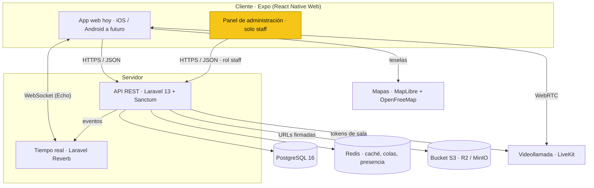

*Figura 1. Arquitectura actual del sistema.*

| Módulo | Función |
| --- | --- |
| **Presentación (frontend)** | Aplicación en Expo que se ejecuta en el navegador de computadoras y celulares; la misma base de código podrá compilarse como app nativa. Muestra perfiles, chats, mapas y menús, y responde a las acciones del usuario. |
| **Lógica y procesamiento (backend)** | Núcleo del sistema, construido con Laravel. Recibe las solicitudes del cliente, valida la identidad y el correo institucional, calcula las coincidencias (matches), gestiona los grupos y aplica las reglas de seguridad y moderación. **[Nuevo]** Valida los permisos de cada rol (estudiante, moderador y administrador) y limita a cada moderador a su universidad. |
| **Comunicación en tiempo real** | Transmite mensajes de chat y notificaciones de match al instante mediante Laravel Reverb, para que las interacciones ocurran sin demoras perceptibles. |
| **Persistencia de datos e imágenes** | Base de datos relacional (PostgreSQL) para cuentas, matches, mensajes y grupos, y almacenamiento privado compatible con S3 para fotos de perfil y archivos compartidos. |
| **Servicio geoespacial y mapas** | Procesa únicamente zonas generales (campus o colonias) y celdas aproximadas, sin guardar ubicaciones exactas ni rastrear en vivo. |
| **Transmisión de video** | Un proveedor especializado (LiveKit) gestiona las videollamadas 1 a 1 entre usuarios con match. |

<details>
<summary>Diagrama inicial entregado en el anteproyecto</summary>

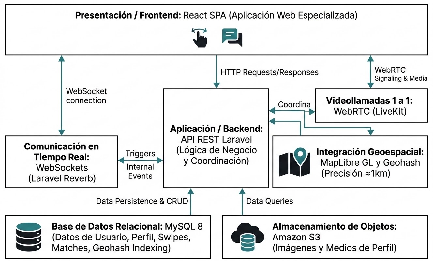

El diagrama inicial mostraba una SPA en React y MySQL 8. El equipo cambió a Expo para el frontend y a PostgreSQL 16 para la base de datos (ver la tabla 12.3).

</details>

##### 12.2 Estructura del sitio (mapa de navegación)

| Ruta | Pantalla | Acceso |
| --- | --- | --- |
| `/login` · `/registro` · `/verificar` | Inicio de sesión, registro y verificación de correo | Público |
| `/perfil/completar` | Asistente de perfil inicial (carrera, intereses, fotos, bio, zona) | Usuario verificado sin perfil |
| `/descubrir` | Descubrimiento tipo swipe con filtros y perfil expandible (modo "Para ti") | Usuario verificado |
| `/descubrir/cerca` | Mapa por zonas con avatares y ficha rápida (modo "Cerca") | Usuario verificado |
| `/matches` · `/chat/:matchId` | Lista de matches y conversación | Usuario verificado |
| `/llamada/:matchId` | Videollamada 1 a 1 | Usuarios con match |
| `/grupos` · `/grupos/:id` · `/grupos/nuevo` | Explorar grupos, detalle con actividades, crear grupo | Usuario verificado |
| `/perfil` · `/perfil/editar` | Perfil propio y edición | Usuario verificado |
| `/ajustes` | Privacidad, usuarios bloqueados, eliminar cuenta, cerrar sesión | Usuario verificado |
| `/admin/reportes` | Panel ~~básico~~ de moderación: **[Nuevo]** reportes de su universidad | **[Nuevo]** Moderador o administrador |
| **[Nuevo]** `/admin/usuarios` · `/admin/usuarios/:id` | Lista, búsqueda y detalle de usuarios; suspender o eliminar una cuenta reportada | Moderador (su universidad) o administrador |
| **[Nuevo]** `/admin/grupos` | Grupos pendientes de aprobación y grupos oficiales | Moderador (su universidad) o administrador |
| **[Nuevo]** `/admin/staff` | Crear, asignar y desactivar moderadores y administradores | Solo administrador |

En móvil la navegación principal es una barra inferior con cuatro secciones: Descubrir, Chats, Grupos y Perfil. En escritorio se convierte en una barra lateral izquierda, y la vista de chat muestra la lista de conversaciones y la conversación en dos columnas. Con Expo Router, cada ruta es un archivo dentro de `src/app/`.

**[Nuevo]** Las cuentas de staff entran directo al panel de administración. Su menú solo muestra Usuarios, Reportes y Grupos, y además Staff en el caso del administrador. No ven Descubrir, Cerca ni Chat.

##### 12.3 Tecnologías y justificación

| Componente | Tecnología | Justificación con base en los requisitos |
| --- | --- | --- |
| **Backend / API** | Laravel 13 (PHP 8.3) | El equipo ya lo domina gracias a un proyecto previo, lo que mitiga el riesgo R6 de curva de aprendizaje; incluye autenticación, validación, colas, eventos, almacenamiento y pruebas integradas (RNF-02, RNF-07). |
| **Autenticación** | Laravel Sanctum | Autenticación por tokens con expiración y revocación, integrada con Laravel (RF-02, RNF-02). |
| **[Nuevo]** **Permisos** | Policies de Laravel | Cada acción del staff se autoriza en el servidor según el rol y la universidad; la app solo oculta lo que el usuario no puede usar (RF-15, RF-22 a RF-24, riesgo R12). |
| **Tiempo real** | Laravel Reverb + Laravel Echo | Servidor WebSocket oficial de Laravel, sin costo por mensaje ni dependencia de un servicio externo; canales privados autenticados para el chat (RF-08, RNF-09). |
| **Base de datos** | PostgreSQL 16 | Modelo relacional adecuado para usuarios, matches, mensajes y grupos. Se eligió sobre MySQL por su soporte geoespacial (PostGIS) para la vista "Cerca", índices parciales, particionado nativo para las tablas que más crecen (swipes y mensajes) y JSONB con índices para atributos de perfil (RF-18, RF-19, RNF-05, RNF-09). |
| **Caché, colas y presencia** | Redis | Caché de la cola de descubrimiento, sesiones, colas de trabajos, contadores de no leídos, estado "en línea" y límite de peticiones en login y registro (RNF-02, RNF-05). |
| **Frontend** | Expo SDK 57 + React Native Web + TypeScript | Una sola base de código para la app web de hoy y para iOS/Android a futuro, sin reescribir pantallas; componentes reutilizables; SDK de LiveKit para React Native; trabajo en paralelo con el backend mediante el contrato OpenAPI (RNF-01, RF-10). |
| **Enrutamiento, datos y estado** | Expo Router; TanStack Query y Zustand | Rutas basadas en archivos que funcionan igual en web y en móvil; caché y sincronización de datos de la API; estado global ligero (sesión, filtros). |
| **Estilos** | `StyleSheet` de React Native con tema propio | Estilos que se comparten entre web y móvil, con los colores y tipografías de la marca centralizados (RNF-01, RNF-10). |
| **Videollamada** | LiveKit tras un Adapter | Evita construir WebRTC, señalización, TURN y SFU desde cero; capa gratuita de 5,000 minutos al mes; opción autoalojada; el Adapter permite cambiar de proveedor (RF-10, riesgos R4, R9 y R11). |
| **Mapa** | MapLibre GL + teselas de OpenFreeMap (alternativa: MapTiler) tras un Adapter | Biblioteca de código abierto sin costo por carga; permite un estilo oscuro propio acorde a la identidad de Kampus; el Adapter permite cambiar de proveedor de teselas (RF-19, RF-20, riesgo R11). |
| **Geolocalización** | API de ubicación del dispositivo + geohash de precisión 6 calculado en el cliente | El GPS solo se usa si el usuario activa "Cerca de ti"; la coordenada exacta nunca sale del dispositivo salvo en un mensaje de ubicación autorizado; el servidor guarda únicamente la zona o la celda (RF-18, RNF-11). |
| **Almacenamiento de imágenes** | Bucket compatible con S3 (Cloudflare R2 o MinIO) | Almacenamiento privado con URLs firmadas temporales para fotos de perfil, chat y grupos (RF-09, RNF-03). |
| **Correo transaccional** | Resend o Mailtrap (en pruebas) | Envío del enlace de verificación institucional (RF-01). |
| **Control de versiones y gestión** | Git + GitHub (Actions) y Plane | Ramas `main`/`develop`, revisión por PR, integración continua con revisión de formato y pruebas; backlog y sprints en Plane (RNF-07). Ver [Unidad 2](#control-de-versiones). |
| **Pruebas** | PHPUnit; Jest + React Native Testing Library | Pruebas automatizadas de los módulos críticos del backend y de los componentes clave del frontend (RNF-07). |
| **Despliegue** | VPS con Docker (Nginx, PHP-FPM, Reverb, PostgreSQL); app web exportada con `expo export` | HTTPS obligatorio para cámara y micrófono (riesgo R2); costo controlado; entorno de pruebas desde el Sprint 3 (RNF-05, RNF-06). |
| **Diseño** | Figma | Wireframes y prototipo navegable; colaboración del equipo de frontend. |
| **Documentación** | Fumadocs (Next.js) en Cloudflare | Este sitio: documentación del proyecto versionada junto al código. |

### Patrones de diseño

*Patrones elegidos y dónde se aplican.*

#### 13. Selección de patrones de diseño

La elección de los patrones responde a las exigencias de creación, arquitectura y comportamiento de los requisitos. Sobre el esquema **MVC** de Laravel se integran los siguientes patrones:

| Tipo | Patrón | Dónde se aplica | Justificación |
| --- | --- | --- | --- |
| Creacional | **Builder** | Búsqueda y descubrimiento de usuarios con filtros | Los filtros son opcionales y combinables (universidad, carrera, intereses, excluir bloqueados y perfiles ya evaluados); el Builder evita condicionales anidados y produce consultas legibles (RF-05, RF-06). |
| Estructural | **Repository** | Acceso a datos de usuarios, matches, mensajes y grupos | Aísla la lógica de negocio de Eloquent, facilita pruebas unitarias con repositorios simulados y concentra las consultas complejas (RNF-07). |
| Estructural | **Adapter** | Servicios externos de videollamada y proveedores de mapas | Desacopla el dominio de los proveedores; permite sustituir LiveKit por Daily o Agora, y OpenFreeMap por MapTiler, sin tocar el resto del sistema (riesgos R4, R9 y R11). |
| De comportamiento | **Observer** | Eventos del sistema (matches, mensajes y reportes) | Un evento dispara varias reacciones (persistir, notificar por WebSocket, registrar) sin acoplar al emisor; es la base del tiempo real (RF-07, RF-08). |
| De comportamiento | **Strategy** | Cálculo de afinidad y orden de perfiles | Permite intercambiar o combinar criterios de ordenamiento y ajustarlos tras las pruebas de usabilidad sin reescribir el servicio de descubrimiento (RF-05). |
| Frontend | **Container/Presentational y Custom Hooks** | Interfaz en Expo (React Native) | Separa la lógica de datos de los componentes visuales, favorece la reutilización y permite probarlos de forma aislada (RNF-01, RNF-07). |

### Wireframes

*Flujo de navegación y pantallas clave en móvil y escritorio.*

#### 14. Wireframes

Los wireframes iniciales están disponibles como archivos SVG editables que se pueden importar en Figma para ajustar textos y formas. Muestran las pantallas clave del proyecto en celular y en computadora, con notas breves en cada sección. Toda la interfaz usa un estilo oscuro (fondos oscuros, detalles en blanco y acentos en amarillo) acorde a la identidad visual de Kampus.

##### 14.1 Flujo de navegación

> [!WARNING]
> **Nuevo · Sprint 2: Módulo de Administración**
>
> Se agrega la rama del **staff** al flujo y la especificación de las pantallas del panel de administración (sección 14.3), **pendientes de diseño** en Figma ([cambio de alcance del 19 de octubre de 2026](#94-cambios-de-alcance)).

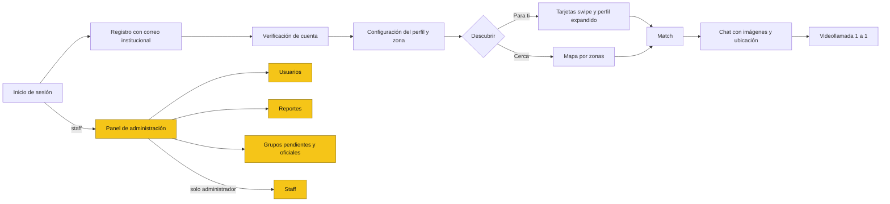

Desde el menú principal se puede navegar en cualquier momento entre **Descubrir**, **Chats**, **Grupos** y **Perfil**. **[Nuevo]** Moderadores y administradores no tienen ese menú: después de iniciar sesión entran al panel de administración.

##### 14.2 Pantallas incluidas

| # | Pantalla | Elementos clave | Móvil / escritorio |
| --- | --- | --- | --- |
| 1 | Inicio de sesión | Logo de Kampus, correo institucional, contraseña, botón Entrar, enlace a registro | Móvil: formulario a una columna. Escritorio: tarjeta centrada con ilustración lateral. |
| 2 | Registro y verificación | Correo institucional con validación de dominio, contraseña, aceptación de privacidad y normas, mensaje de "revisa tu correo" | Mismo diseño; en escritorio se muestra la lista de dominios aceptados junto al formulario. |
| 3 | Perfil (crear o editar) | Fotos (hasta 5), universidad, carrera y semestre, zona (campus y colonia), interruptor "Cerca de ti" con su explicación, chips de intereses y biografía | Móvil: secciones apiladas. Escritorio: fotos a la izquierda y datos a la derecha. |
| 4 | Descubrir — Para ti | Selector "Para ti / Cerca", tarjeta con foto, nombre e insignia de verificación, universidad y carrera, intereses, indicador de deslizar, botones Pasar / Me interesa e icono de filtros | Móvil: gestos táctiles y tarjeta a pantalla completa. Escritorio: tarjeta centrada con filtros en panel lateral. |
| 5 | Perfil expandido | Foto principal con nombre e insignia, universidad, carrera y semestre, galería, "Sobre mí", intereses y grupos en común; acciones siempre visibles | Móvil: se abre al deslizar hacia arriba. Escritorio: panel lateral o ventana modal. |
| 6 | Descubrir — Cerca (mapa) | Mapa oscuro propio, zonas etiquetadas, avatares en el centro de su zona, anillo punteado de zona aproximada, ficha con distancia ("≈ 2 km") y botón para centrar en mi zona | Móvil: mapa a pantalla completa con ficha inferior. Escritorio: mapa amplio con ficha a la derecha. |
| 7 | Matches y chats | Fila horizontal de nuevos matches y lista de conversaciones con último mensaje y no leídos | Móvil: pantalla propia. Escritorio: columna izquierda fija dentro de la vista de chat. |
| 8 | Conversación | Encabezado con nombre y botón de videollamada, burbujas de texto e imágenes, mensaje de ubicación como mini-mapa, menú de adjuntar (imagen o ubicación) con confirmación y campo de texto | Móvil: pantalla completa. Escritorio: columna derecha junto a la lista de chats. |
| 9 | Videollamada 1 a 1 | Video remoto grande, video propio en miniatura, controles de micrófono, cámara y colgar, y guía de permisos | Móvil: vertical con controles inferiores. Escritorio: video centrado y controles flotantes. |
| 10 | Grupos y clubes | Buscador y filtros por institución y categoría, tarjetas de grupo con miembros y próxima actividad, botón Unirse y botón Crear grupo | Móvil: lista a una columna. Escritorio: cuadrícula de tres columnas. |

##### 14.3 Pantallas del panel de administración (pendiente de diseño)

Especificación para que el equipo de frontend diseñe estas pantallas en Figma (T-44). Usan el mismo estilo oscuro y los componentes de la guía de estilo.

| # | Pantalla | Elementos clave | Móvil / escritorio |
| --- | --- | --- | --- |
| A1 | Panel · Usuarios | Buscador por nombre o correo, filtro por estado (activa / suspendida), lista con nombre, carrera, universidad y número de reportes. El moderador solo ve su universidad; el administrador tiene además un selector de universidad. | Móvil: lista a una columna. Escritorio: tabla con barra lateral del panel. |
| A2 | Detalle de usuario | Datos de la cuenta y del perfil, reportes recibidos y historial de la bitácora. Botones Suspender, Reactivar y Eliminar; el moderador solo los ve si la cuenta tiene un reporte. Al confirmar, pide el motivo (obligatorio). | Móvil: pantalla completa. Escritorio: panel derecho junto a la lista. |
| A3 | Reportes | Pestañas Pendientes / Revisados / Descartados; cada reporte con motivo, fecha, quién reporta y a quién, y acceso a la conversación que sirve como evidencia. Acciones: descartar, o resolver y suspender, con motivo. | Móvil: lista con ficha inferior. Escritorio: lista y detalle en dos columnas. |
| A4 | Grupos | Pestañas Pendientes / Oficiales; tarjeta con nombre, categoría, creador e imagen; botones Aprobar y Rechazar (el rechazo pide motivo) y Crear grupo oficial. | Móvil: lista a una columna. Escritorio: cuadrícula. |
| A5 | Staff (solo administrador) | Lista de moderadores y administradores con universidad y estado; formulario para crear una cuenta (nombre, correo institucional, rol, universidad) y botón Desactivar. | Móvil: lista y formulario en pantalla aparte. Escritorio: lista con formulario lateral. |

Del lado del estudiante cambia la pantalla 10 (Grupos): el grupo que crea muestra el estado "En revisión" o el motivo del rechazo, y los grupos oficiales llevan una insignia.

##### Wireframes móvil (360 × 740)

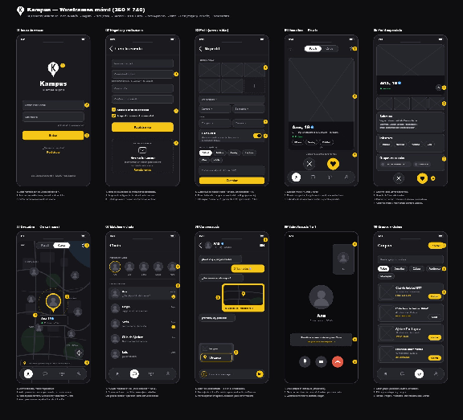

##### Wireframes escritorio (1280 × 800)

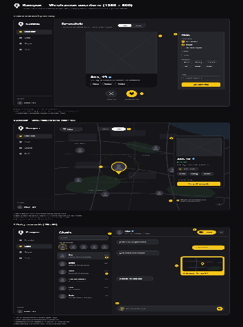

##### Archivos editables

Cada pantalla está en un SVG por separado, con la paleta y la tipografía de Kampus y capas con nombre, listo para arrastrar a Figma. Cómo armar el prototipo: [Prototipo y maquetado](#cómo-armar-el-prototipo-en-figma).

| Archivo | Pantalla |
| --- | --- |
| [`00-guia-de-estilo.svg`](public/docs/project/wireframes/00-guia-de-estilo.svg) | Colores, tipografía y componentes base (1280 × 800) |
| [`movil-01-inicio-sesion.svg`](public/docs/project/wireframes/movil-01-inicio-sesion.svg) | 1 · Inicio de sesión |
| [`movil-02-registro.svg`](public/docs/project/wireframes/movil-02-registro.svg) | 2 · Registro y verificación |
| [`movil-03-perfil-editar.svg`](public/docs/project/wireframes/movil-03-perfil-editar.svg) | 3 · Perfil (crear o editar) |
| [`movil-04-descubrir-para-ti.svg`](public/docs/project/wireframes/movil-04-descubrir-para-ti.svg) | 4 · Descubrir — Para ti |
| [`movil-05-perfil-expandido.svg`](public/docs/project/wireframes/movil-05-perfil-expandido.svg) | 5 · Perfil expandido |
| [`movil-06-descubrir-cerca.svg`](public/docs/project/wireframes/movil-06-descubrir-cerca.svg) | 6 · Descubrir — Cerca (mapa) |
| [`movil-07-chats.svg`](public/docs/project/wireframes/movil-07-chats.svg) | 7 · Matches y chats |
| [`movil-08-conversacion.svg`](public/docs/project/wireframes/movil-08-conversacion.svg) | 8 · Conversación |
| [`movil-09-videollamada.svg`](public/docs/project/wireframes/movil-09-videollamada.svg) | 9 · Videollamada 1 a 1 |
| [`movil-10-grupos.svg`](public/docs/project/wireframes/movil-10-grupos.svg) | 10 · Grupos y clubes |
| [`escritorio-01-descubrir.svg`](public/docs/project/wireframes/escritorio-01-descubrir.svg) | Escritorio · Descubrir con filtros |
| [`escritorio-02-cerca.svg`](public/docs/project/wireframes/escritorio-02-cerca.svg) | Escritorio · Cerca con mapa |
| [`escritorio-03-chat.svg`](public/docs/project/wireframes/escritorio-03-chat.svg) | Escritorio · Chat a dos columnas |

### Definición de contenido

*Tono, identidad visual, tipografía y licencias de los recursos.*

#### 15. Definición de contenido

##### 15.1 Textos y tono de comunicación

- **Idioma y tono.** Español de México, con expresiones familiares para la comunidad universitaria de la Comarca Lagunera, sin perder claridad. Tono cercano, empático, inclusivo e informal pero respetuoso. Se usa el tuteo en toda la interfaz para generar confianza con los estudiantes de nuevo ingreso. Se evita el lenguaje burocrático; las llamadas a la acción usan verbos claros ("Descubrir conexiones", "Unirme al club", "Iniciar chat").
- **Textos de la aplicación (UX writing).** Microtexto para cada etapa del usuario. La bienvenida refuerza el sentido de pertenencia con frases como "Tu campus, tu gente" y "Conecta con tu comunidad universitaria". Los estados vacíos orientan la acción ("Aún no tienes matches activos, ¡sigue explorando perfiles en tu campus!"). Los errores son descriptivos y orientados a la solución ("El correo ingresado no pertenece a los dominios autorizados de UTT, UAdeC o Tec Laguna; verifica tu dirección institucional"). Las acciones irreversibles (bloquear, reportar, eliminar la cuenta) piden confirmación explícita.
- **Consentimiento de ubicación y privacidad.** Antes de activar la geolocalización se muestra una pantalla de permiso que explica: "Utilizamos tu ubicación únicamente para ubicarte en una celda de área aproximada (~1 km), salvaguardando tu posición exacta". Al compartir la ubicación en el chat se advierte: "Vas a compartir tu ubicación puntual en este mensaje. ¿Deseas continuar?". La opción para desactivar "Cerca de ti" y borrar los datos de ubicación está siempre disponible en Ajustes.
- **Documentos legales.** Aviso de Privacidad Integral conforme a la LFPDPPP, que detalla la recolección, uso y supresión de datos sensibles (fotos y celdas geográficas). Términos de Uso y Normas de Comunidad que prohíben acoso, suplantación, lenguaje de odio y contenido explícito. Se excluyen de forma permanente las suscripciones de pago, las fotos bloqueadas y el contenido +18.
- **Catálogos predefinidos.**
  1. Instituciones participantes (UTT, UAdeC, Tec Laguna) con sus dominios de correo.
  2. Carreras y programas académicos vigentes por campus.
  3. Intereses organizados por categoría (deportes, cultura, tecnología, videojuegos, voluntariado, artes, idiomas, etc.).
  4. Clasificación de grupos y clubes (deportivo, cultural, académico, social).
  5. Sectores y zonas de la Comarca Lagunera.
  6. Motivos de reporte (acoso, perfil falso, contenido inapropiado, spam, otro).

##### 15.2 Imágenes e identidad visual

- **Fotografías de usuario y grupo.** JPG, WebP o PNG de hasta 5 MB. Recorte automático 1:1 para avatares circulares y 4:5 para las tarjetas de Descubrir. Compresión previa para cargar rápido en redes móviles sin perder nitidez.
- **Logotipo y marca.** Logotipo vectorial original: un pin de ubicación estilizado con la letra K, sobre la abstracción de un campus universitario. Paleta de tema oscuro:

  | Uso | Color |
  | --- | --- |
  | Fondo principal | `#121215` |
  | Tarjetas y contenedores | `#2C2C33` y `#1A1A1E` |
  | Texto y elementos neutros | `#FFFFFF` |
  | Acento de marca (botones primarios, estados activos, match, marcadores) | `#F5C518` |

- **Mapas.** Estilo vectorial JSON personalizado para MapLibre/OpenFreeMap con contraste nocturno: superficies en `#1A1A1E`, calles secundarias en `#2A2A30`, parques y agua en `#22302A`. Los avatares se muestran en pines circulares con borde `#F5C518` y un halo punteado que delimita la zona.
- **Ilustraciones.** Biblioteca unDraw, personalizada en SVG con el amarillo y los grises de la marca, para onboarding, confirmaciones y estados vacíos.
- **Iconografía.** Lucide Icons: trazos limpios de 2 px para la navegación (Descubrir, Chats, Grupos, Perfil), llamadas, adjuntos, filtros y ajustes.
- **Imágenes de demostración.** Solo fotografías libres de derechos (Unsplash, Pexels). Está prohibido usar fotos reales de alumnos sin su consentimiento firmado.

##### 15.3 Tipografía

| Uso | Familia | Pesos |
| --- | --- | --- |
| Cuerpo e interfaz | **Inter** (Google Fonts) | Regular 400 para descripciones y chats; Medium 500 para etiquetas, menús e insignias |
| Encabezados e impacto | **Poppins** | SemiBold 600 y Bold 700 para títulos, nombres en tarjetas, botones primarios y "Es un match" |

**Escala y accesibilidad.** Tamaño base de 16 px (1 rem), mínimo de 14 px en móvil. Escala modular 1.25 (Major Third): H1 32 px, H2 25 px, H3 20 px, cuerpo 16 px, microtexto 12–14 px. Todos los pares texto-fondo cumplen el contraste WCAG AA (mínimo 4.5:1).

##### 15.4 Criterios de selección y licencias

- **Licencias.** Todo recurso integrado (multimedia, fuentes, bibliotecas, iconos) debe tener licencia permisiva para uso académico y comercial: Open Font License para fuentes, MIT/Apache 2.0 para bibliotecas e iconos, CC0/Unsplash License para imágenes. Se lleva un registro en `ATTRIBUTION.md` en la raíz del repositorio.
- **Identidad institucional.** No se usan logotipos, escudos ni marcas de las universidades participantes sin autorización por escrito. Las instituciones se mencionan solo por su nombre.
- **Contenido generado por usuarios.** Las fotos, descripciones, mensajes y publicaciones siguen siendo propiedad de cada alumno, con una licencia de uso limitada a la plataforma para mostrarlos. Kampus puede retirar cualquier contenido que infrinja las normas de comunidad o el aviso de privacidad.
- **Textos centralizados.** Todo el microtexto vive en archivos de recursos (i18n/JSON) dentro del frontend. Así se mantiene la consistencia, el Product Owner puede revisar estilo y ortografía, y la app queda lista para otros idiomas.

## Unidad 2 · Versionamiento y diseño

### Rúbrica y avance

*Qué evalúa la Unidad 2, dónde se cubre cada criterio y cómo vamos.*

**Actividad:** Avances del proyecto · **Asignatura:** Desarrollo Web Integral · **Profesor:** Jesús Del Toro Robledo · **Fecha de revisión:** 20 de octubre de 2026

Escala de desempeño: 5 Excelente (10) · 4 Bien (9.5) · 3 Suficiente (9) · 2 Deficiente (8) · 1 Insuficiente (menor a 8). La calificación final es el promedio de los criterios generales y los específicos.

#### Avance por criterio

| Criterio específico | Dónde se cubre | Estado |
| --- | --- | :---: |
| Maquetado | [Prototipo y maquetado](#prototipo-y-maquetado) · [Capturas](#capturas-1) | ✅ |
| Prototipado | [Prototipo y maquetado](#prototipo-y-maquetado) · [Wireframes](#wireframes) · [Figma](https://www.figma.com/proto/1l4aKYvdrpLcIa8OO8JcD2/Kampus-%E2%80%94-Prototipo?page-id=1%3A2&node-id=1-592&starting-point-node-id=1%3A592&scaling=min-zoom&content-scaling=fixed) | ✅ |
| Documentación en repositorio (README / Unidades 1 y 2) | Esta sección y el [`README.md`](https://github.com/reyes200205/Docs-Kampus#readme) del repositorio · [sitio publicado](https://doc.kodev.online/) | ✅ |
| Justificación de la herramienta y plataforma de versionamiento | [Control de versiones](#control-de-versiones) | ✅ |
| Definición y diseño del flujo de trabajo (workflow) | [Flujo de trabajo](#flujo-de-trabajo) | ✅ |
| Configuración y parámetros del entorno de versiones | [Configuración de los repositorios](#configuración-de-los-repositorios) | ✅ |
| Repositorio en funcionamiento y evidencias | [Repositorios y evidencias](#repositorios-y-evidencias) · [Changelog](https://doc.kodev.online/changelog) | ✅ |
| Diagramas del sistema (arquitectura / casos de uso / DER) | [Diagramas](#diagramas-del-sistema) | ✅ |
| Diccionario de datos | [Diccionario de datos](#diccionario-de-datos) | ✅ |

#### Criterios específicos: Unidad 2 (control de versiones, diagramas y diccionario de datos)

| Criterio | Excelente (5 / 10) | Bien (4 / 9) | Suficiente (3 / 8.5) | Deficiente (2 / 8) | Insuficiente (1 / < 8) |
| --- | --- | --- | --- | --- | --- |
| **Maquetado** | Maquetado completo, estructurado y fiel a los requerimientos de diseño e interfaz, aplicando estándares web modernos y semántica adecuada. | Maquetado funcional con detalles menores de estructura o semántica. | Maquetado básico, incompleto o con problemas de diseño visual. | Maquetado deficiente y desorganizado. | Ausente o sin relación con los requerimientos. |
| **Prototipado** | Prototipo estructurado que define con claridad el flujo de navegación, la distribución de pantallas y la experiencia de usuario. | Prototipo adecuado con pocos detalles omitidos en la interacción. | Prototipo básico o incompleto que dificulta visualizar el flujo. | Prototipo muy pobre o confuso. | Ausente. |
| **Documentación en repositorio (README / Unidades 1 y 2)** | El documento de la Unidad 1 y la documentación de la Unidad 2 se encuentran perfectamente integrados y estructurados en un archivo README dentro del repositorio remoto elegido. | Documentación completa en el README con detalles menores de formato. | Documentación incompleta o desorganizada dentro del repositorio. | Documentación muy escasa o ubicada fuera del repositorio. | Ausente. |
| **Justificación de la herramienta y plataforma de versionamiento** | Justificación sólida y técnica de la elección del sistema de control de versiones (Git) y plataforma (GitHub, GitLab, etc.) basada en las necesidades del proyecto. | Elección justificada de manera adecuada con breves argumentos. | Elección indicada sin una justificación clara o superficial. | Elección arbitraria o sin relación con el proyecto. | Ausente. |
| **Definición y diseño del flujo de trabajo (workflow)** | Establecimiento detallado del flujo de trabajo (p. ej. Git Flow, GitHub Flow), nomenclatura de ramas, políticas de combinación y gestión de pull requests. | Flujo de trabajo definido con pocos detalles omitidos en las políticas de ramas. | Flujo de trabajo genérico o incompleto sin políticas claras de combinación. | Mención vaga del flujo de trabajo sin estructura operativa. | Ausente. |
| **Configuración y parámetros del entorno de versiones** | Configuración correcta de parámetros iniciales, control de accesos, archivos de exclusión (`.gitignore`) y llaves o credenciales de seguridad. | Configuración adecuada con detalles menores faltantes en la documentación. | Configuración incompleta o con errores en la estructura del repositorio. | Configuración errónea que dificulta el control de versiones. | Ausente. |
| **Repositorio en funcionamiento y evidencias** | Enlace funcional a un repositorio remoto activo que demuestra la aplicación real del flujo de trabajo, commits estructurados y participación colaborativa del equipo. | Repositorio funcional con detalles menores en la estructuración de commits o historial de ramas. | Repositorio con actividad escasa, ramas desorganizadas o sin seguir el flujo acordado. | Repositorio creado pero vacío o sin evidencia de colaboración. | Ausente. |
| **Diagramas del sistema (arquitectura / casos de uso / DER)** | Diagramas claros, normalizados (UML / entidad-relación) y alineados a los requerimientos, que reflejan de forma lógica la estructura y el comportamiento del sistema. | Diagramas correctos con detalles menores de notación o estética. | Diagramas incompletos, confusos o con errores de sintaxis o notación. | Diagramas genéricos que no corresponden al caso de estudio. | Ausente. |
| **Diccionario de datos** | Estructura de datos documentada a detalle (tabla/entidad, campos, tipos de datos, restricciones, llaves primarias/foráneas y descripciones claras). | Diccionario completo con omisiones menores en descripciones o tipos. | Diccionario incompleto o con inconsistencias respecto a los diagramas. | Listado básico de variables o tablas sin especificaciones técnicas. | Ausente. |

#### Criterios generales

| Criterio | Excelente (5 / 10) | Bien (4 / 9) | Suficiente (3 / 8.5) | Deficiente (2 / 8) | Insuficiente (1 / < 8) |
| --- | --- | --- | --- | --- | --- |
| **Cumplimiento de la actividad** | Realiza la actividad completa, cumpliendo con todas las instrucciones. | Realiza la mayoría de las instrucciones, con pocos errores. | Cumple parcialmente; faltan partes importantes. | No cumple con las instrucciones; la actividad está incompleta. | La actividad está ausente. |
| **Calidad del trabajo** | Contenido profundo, bien organizado y de alta calidad. | Contenido claro, con algunas áreas de mejora. | Contenido básico, poco organizado o superficial. | Contenido pobre, desorganizado o incorrecto. | Contenido pobre, desorganizado o incorrecto, con escasa limpieza. |
| **Creatividad y originalidad** | Presenta ideas innovadoras, reflexiones propias o recursos originales. | Algunas ideas propias, con buena presentación. | Poca creatividad, se limita a lo común. | Sin creatividad ni aportaciones propias. | Sin aportaciones propias y con evidente falta de originalidad o copia. |
| **Presentación y orden** | Trabajo muy limpio, ordenado, con formato adecuado. | Pocos errores de orden o limpieza. | Desorden, errores de formato o descuido. | Muy desordenado, ilegible o incompleto. | Muy desordenado, ilegible, incompleto o sucio. |
| **Ortografía y redacción** | Sin errores ortográficos ni de expresión; comunicación clara. | Pocos errores que no afectan la comprensión. | Varios errores que dificultan la lectura. | Muchos errores que impiden la comprensión. | Errores graves y evidentes. |
| **Entrega y responsabilidad** | Se entrega puntualmente y demuestra responsabilidad. | Mínimo retraso o pequeños detalles. | Retraso considerable. | No se entrega o no cumple con lo solicitado. | No cumple o se presenta a destiempo. |

### Guion de la revisión

Guion para la revisión de la Unidad 2 (20 de octubre de 2026). No hay presentación con diapositivas: cada integrante explica sus criterios y muestra la página del sitio donde están. El reparto lo propuso Luis en Slack.

| # | Criterio | Presenta | Dónde mostrarlo |
| --- | --- | --- | --- |
| 1 | Definición de contenido | Jorge | [Contenido](#definición-de-contenido) |
| 2 | Prototipado | Luis | [Prototipo](#prototipo-y-maquetado) · [Wireframes](#wireframes) |
| 3 | Diagramas del sistema | Mario | [Diagramas](#diagramas-del-sistema) |
| 4 | Diccionario de datos | Mario | [Diccionario de datos](#diccionario-de-datos) |
| 5 | Control de versiones | Wilbert | [Control de versiones](#control-de-versiones) |
| 6 | Flujo de trabajo | Wilbert | [Flujo de trabajo](#flujo-de-trabajo) |
| 7 | Configuración del entorno de versiones | Wilbert | [Configuración](#configuración-de-los-repositorios) |
| 8 | Maquetado | Marcelo | [Maquetado](#maquetado) · [Capturas](#capturas-1) |
| 9 | Repositorio y evidencias | Marcelo | [Evidencias](#repositorios-y-evidencias) · [Changelog](https://doc.kodev.online/changelog) |
| 10 | Documentación en el README | Jorge | [README](#índice) · [Rúbrica y avance](#rúbrica-y-avance) |

#### 1. Definición de contenido · Jorge

Antes de diseñar o programar definimos la **identidad del proyecto**: el **tono** de comunicación, la **identidad visual**, la **tipografía** y las **licencias** de los recursos que usamos, como imágenes, íconos y fuentes. Así evitamos problemas de derechos de autor y mantenemos coherencia en toda la app.

Como Product Owner, esta definición sirvió de guía para que backend y frontend trabajaran con los mismos requerimientos desde el inicio.

#### 2. Prototipado · Luis

Con esa base elaboramos los **wireframes** (10 pantallas en móvil y 3 vistas de escritorio) y el **prototipo navegable en Figma**. El prototipo no es solo dibujar pantallas: define con claridad tres cosas.

1. El **flujo de navegación**, es decir, cómo pasa el usuario de una pantalla a otra.
2. La **distribución de cada pantalla**: dónde va el menú, el contenido y los botones.
3. La **experiencia de usuario**: que sea intuitiva y consistente.

Hacerlo antes del código nos permitió detectar errores de diseño cuando corregirlos todavía era barato. Además, el prototipo es la referencia directa del maquetado.

#### 3. Diagramas del sistema · Mario

Para documentar la estructura y el comportamiento del sistema elaboramos tres diagramas:

- **Arquitectura:** los componentes y cómo se comunican. La app en Expo, la API REST en Laravel, la base de datos PostgreSQL y los servicios de tiempo real (Reverb), videollamada (LiveKit), almacenamiento y mapas.
- **Casos de uso (UML):** los actores (Visitante, Estudiante, Moderador y Administrador) y lo que puede hacer cada uno.
- **Entidad-relación (DER):** las entidades, sus atributos, sus relaciones y su cardinalidad.

Usamos notación normalizada para que cualquier persona con conocimientos técnicos pueda interpretarlos, y los alineamos a los requerimientos. Lo que agregó el módulo de Administración del Sprint 2 está resaltado en amarillo.

#### 4. Diccionario de datos · Mario

El diccionario documenta las 17 tablas del dominio. Por cada campo indicamos su **nombre, tipo de dato, restricciones** (NOT NULL, UNIQUE o valor por defecto), si es **llave primaria o foránea** y una **descripción clara**. También incluye los catálogos de valores y la trazabilidad de cada tabla con los requisitos.

Lo revisamos contra el DER para que sean **consistentes**: cada entidad del diagrama tiene su tabla en el diccionario y cada relación aparece como llave foránea. Esa consistencia es donde más suelen fallar estas entregas, por eso la verificamos.

#### 5. Control de versiones: Git y GitHub · Wilbert

Elegimos **Git** porque es un sistema **distribuido**: cada integrante tiene una copia completa del historial, puede trabajar sin conexión y crear ramas de forma rápida. Eso encaja con nuestro equipo, donde backend y frontend desarrollan partes distintas al mismo tiempo. Además es gratuito y es el estándar de la industria.

Elegimos **GitHub** porque ofrece repositorios remotos gratuitos, **pull requests** con revisión de código, control de colaboradores y permisos, **protección de ramas**, GitHub Actions para la integración continua y Releases para publicar versiones. En la página comparamos Git con SVN y Mercurial, y GitHub con GitLab y Bitbucket.

#### 6. Flujo de trabajo · Wilbert

Como Scrum Master definí un **Git Flow simplificado**. Sus reglas son:

- **`main`** solo tiene código estable y publicado; nadie trabaja directamente sobre ella.
- **`develop`** es la rama de integración y el destino de todos los PR de tarea.
- Cada tarea se desarrolla en una **rama propia** con el número de la tarea: `feature/T-02-migraciones`, `fix/dependencias-t44` o `docs/T-40-modulo-administracion`.
- Los cambios entran por **pull request**, que otro integrante revisa antes del merge.
- Los **commits** siguen la convención `tipo: descripción` (`feat:`, `fix:`, `docs:`). Un check de CI la revisa en los tres repositorios.
- Al pasar `develop` a `main` se publica una **versión automática** con su changelog.
- Cada rama y PR lleva el número `T-XX` de su tarea en Plane.

Así cada cambio queda trazado: quién lo hizo, por qué y quién lo revisó.

#### 7. Configuración del entorno de versiones · Wilbert

- **Identidad:** cada integrante configuró su nombre y correo en Git, para que los commits se le atribuyan.
- **Exclusiones:** un `.gitignore` por repositorio excluye dependencias, compilados, archivos del editor, registros y variables de entorno. El `.env.example` sirve de plantilla sin valores secretos.
- **Control de accesos:** el dueño de cada repositorio es administrador y el resto del equipo es colaborador con permiso de escritura.
- **Protección de ramas:** `main` y `develop` están protegidas en los tres repositorios. Piden pull request y bloquean el force push y el borrado. En el backend y en la app, además, piden una aprobación de otro integrante, y en el backend también que pase el check *Formato y pruebas*.
- **Credenciales:** cada integrante se autentica con su llave SSH o su token personal. Las contraseñas y llaves nunca se suben; los secretos de CI viven en *GitHub Secrets*.

Todo está documentado en la página de Configuración y en el README.

#### 8. Maquetado · Marcelo

El maquetado traduce el prototipo de Figma a código. La app usa **Expo con React Native Web** y Expo Router: cada archivo de `src/app/` es una ruta, y la misma pantalla funciona en web y en móvil.

- **Semántica y accesibilidad:** cada control tiene su etiqueta accesible (`accessibilityLabel`), los títulos usan `accessibilityRole="header"` y en web se convierten en encabezados reales. Además: contraste AA y áreas táctiles de al menos 44 px.
- **Estilos:** un tema propio con los colores, la tipografía y el espaciado de la marca, compartido entre web y móvil.
- **Responsividad:** funciona de 360 px a 1920 px. En celular la navegación es una barra inferior y en escritorio se convierte en barra lateral.

**Avance:** están maquetados el inicio de sesión, el registro con verificación, la recuperación de contraseña, el aviso de privacidad, las normas y la navegación principal. Perfil, Descubrir, Chats y Grupos tienen su estructura; su contenido completo y las demás pantallas siguen en los Sprints 2 a 4, según el cronograma.

#### 9. Repositorio y evidencias · Marcelo

Los tres repositorios están activos y son públicos:

- [backend-kampus](https://github.com/WilbertDevMx/backend-kampus)
- [Frontend-Kampus](https://github.com/reyes200205/Frontend-Kampus)
- [Docs-Kampus](https://github.com/reyes200205/Docs-Kampus)

Su historial muestra el flujo de trabajo aplicado en la práctica: ramas por tarea, pull requests revisados, commits con mensajes estructurados y versiones publicadas (backend v0.1.0, app v0.2.0, documentación v0.4.x). La aportación de cada integrante está en la tabla de participación de [Evidencias](#participación-del-equipo).

#### 10. Documentación en el README · Jorge

El `README.md` integra el documento de la Unidad 1 y toda la documentación de la Unidad 2 en un solo lugar, dentro del repositorio remoto. Tiene índice, secciones ordenadas y formato consistente. Incluye la rúbrica de avance, el control de versiones, el flujo de trabajo, la configuración, los repositorios y evidencias, los diagramas y el diccionario de datos. El mismo contenido se publica en este sitio.

### Control de versiones

*Por qué Git como sistema de versiones y GitHub como plataforma.*

#### Necesidades del proyecto

Antes de elegir herramientas, el equipo identificó lo que el proyecto exige:

| Necesidad | Origen |
| --- | --- |
| Cinco integrantes trabajando en paralelo sobre tres bases de código (backend, app y documentación) | Roles del equipo (9.2) |
| Revisión obligatoria por otro integrante antes de integrar código | Definition of Done y RNF-07 |
| Pruebas y revisión de formato automáticas en cada cambio | RNF-07, T-01 |
| Trazabilidad entre cada cambio y su tarea `T-XX` y requisito | Separación en tareas (10) |
| Publicar versiones y un changelog sin trabajo manual | Entregas incrementales por sprint |
| Costo cero | Riesgo R9 (presupuesto) |

#### Sistema de control de versiones: Git

| Criterio | Git | Subversion (SVN) | Mercurial |
| --- | --- | --- | --- |
| Modelo | Distribuido: cada integrante tiene el historial completo | Centralizado: depende del servidor | Distribuido |
| Ramas | Ligeras e instantáneas; una por tarea sin costo | Copias de directorio, costosas | Ligeras, pero poco usadas en la práctica |
| Trabajo sin conexión | Commits, ramas e historial locales | Requiere conexión para casi todo | Sí |
| Ecosistema | Estándar de la industria; integrado en Laravel, Expo, VS Code y todos los servicios de CI | Soporte decreciente | Pocas plataformas lo alojan |
| Experiencia del equipo | Todos lo usan desde cuatrimestres anteriores | Ninguna | Ninguna |

**Decisión:** Git. Su modelo distribuido y sus ramas ligeras permiten el flujo de **una rama por tarea**, que es la base de la trazabilidad `T-XX`. Además es la herramienta que el equipo ya domina, lo que reduce el riesgo R6 (curva de aprendizaje).

#### Plataforma: GitHub

| Criterio | GitHub | GitLab | Bitbucket |
| --- | --- | --- | --- |
| Pull requests y revisión | Revisión por líneas, aprobaciones obligatorias, plantillas de PR | Merge requests equivalentes | Sí, más limitado |
| CI/CD | GitHub Actions integrado; minutos gratuitos y gratis en repositorios públicos | GitLab CI integrado, con menos minutos gratuitos | Pipelines con pocos minutos gratuitos |
| Protección de ramas | Reglas por rama (PR obligatorio, checks en verde, sin push directo) | Sí | Sí |
| Publicación de versiones | Releases con notas generadas a partir de los commits | Sí | No nativo |
| Beneficio educativo | GitHub Student Developer Pack | GitLab for Education (requiere solicitud institucional) | Sin equivalente |
| Integraciones del proyecto | Plane (tareas), Cloudflare (despliegue de la documentación) | Plane | Limitadas |
| Experiencia del equipo | Todos tienen cuenta y portafolio en GitHub | Poca | Ninguna |

**Decisión:** GitHub. Cubre todas las necesidades sin costo: pull requests con revisión obligatoria, GitHub Actions para la integración continua y la publicación de versiones, protección de ramas y Releases para el changelog. Al ser la plataforma que el equipo ya usa, no agrega curva de aprendizaje.

#### Cómo se usa en Kampus

| Herramienta | Uso |
| --- | --- |
| **Git** | Historial, ramas por tarea y commits con [convención](https://doc.kodev.online/docs/development/commits). |
| **GitHub** | Repositorios remotos, pull requests, revisión y protección de ramas. |
| **GitHub Actions** | CI del backend (formato, migraciones y pruebas); revisión de commits, versionado y despliegue de la documentación. |
| **GitHub Releases** | Versiones y changelog automáticos ([/changelog](https://doc.kodev.online/changelog)). |
| **Plane** | Backlog, sprints y tareas `T-XX` que dan nombre a las ramas. |

### Flujo de trabajo

*Git Flow simplificado: ramas, nomenclatura, políticas de merge y pull requests.*

El equipo usa un **Git Flow simplificado**: conserva las ramas `main` y `develop` de Git Flow, pero sin ramas `release/*` ni `hotfix/*`, porque las versiones se publican automáticamente al llevar `develop` a `main`.

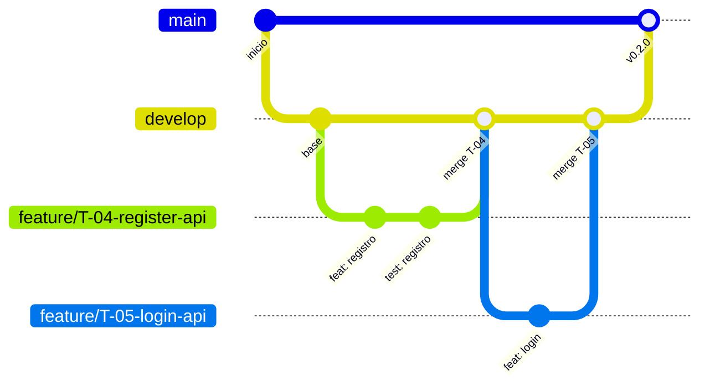

#### Ramas

| Rama | Propósito | Quién escribe |
| --- | --- | --- |
| `main` | Código estable y publicado. Cada merge genera una versión. | Solo PR de publicación desde `develop` |
| `develop` | Integración; rama por defecto y destino de todos los PR de tarea. | Solo PR de tarea |
| `feature/T-XX-descripcion` | Una rama por tarea del cronograma. | Responsable de la tarea |
| `fix/descripcion` | Corrección de un error. | Quien lo corrige |
| `docs/T-XX-descripcion` | Documentación de una tarea (esquema, diagramas, páginas). | Responsable de la tarea |
| `chore/descripcion` · `ci/descripcion` | Configuración, dependencias y workflows. | Quien lo configura |

#### Nomenclatura

- **Ramas:** prefijo del tipo de cambio, en minúsculas y con guiones, con el número de la tarea cuando la hay: `feature/T-02-migraciones`, `docs/T-40-modulo-administracion`, `fix/dependencias-t44`. La descripción va en español, como los commits.
- **Commits:** `tipo: descripción en presente`, en español (`feat: agrega el endpoint de registro`). Ver [Commits](https://doc.kodev.online/docs/development/commits).
- **Pull requests:** el título sigue la misma convención; la plantilla pide la tarea `T-XX` y el requisito `RF-XX`.

#### Políticas de combinación

| Regla | Detalle |
| --- | --- |
| Sin push directo | Nadie hace push a `main` ni a `develop`; todo entra por pull request. |
| Revisión obligatoria | Al menos una aprobación de otro integrante. |
| Checks en verde | CI del backend (formato, migraciones y pruebas) o revisión de commits en la documentación. |
| PR de tarea → `develop` | **Create a merge commit**: se conservan los commits de la tarea, que CI revisa uno por uno y que alimentan el changelog. |
| PR de publicación `develop` → `main` | **Create a merge commit**: se conservan los commits para generar el changelog. |
| Después del merge | Se borra la rama de la tarea y se cierra la tarea en Plane. |

#### Ciclo de una tarea

1. Toma la tarea `T-XX` en Plane y crea la rama desde `develop` actualizado.
2. Trabaja con commits pequeños que sigan la convención.
3. Sube la rama y abre el PR hacia `develop` con la plantilla llena.
4. Espera los checks y la aprobación; atiende los comentarios.
5. Mergea con *Create a merge commit*, borra la rama y cierra la tarea.

Las guías paso a paso están en [Flujo de Git](https://doc.kodev.online/docs/development/git-workflow), [Pull requests](https://doc.kodev.online/docs/development/pull-requests) y [Versiones y changelog](https://doc.kodev.online/docs/development/releases).

### Configuración de los repositorios

*Parámetros iniciales, accesos, archivos de exclusión y manejo de credenciales.*

#### Repositorios

El proyecto se divide en tres repositorios independientes, uno por aplicación:

| Repositorio | Contenido | Rama por defecto |
| --- | --- | --- |
| [`backend-kampus`](https://github.com/WilbertDevMx/backend-kampus) | API REST en Laravel | `develop` |
| [`Frontend-Kampus`](https://github.com/reyes200205/Frontend-Kampus) | App en Expo (web y móvil) | `main` |
| [`Docs-Kampus`](https://github.com/reyes200205/Docs-Kampus) | Este sitio de documentación | `develop` |

Separarlos permite que cada parte tenga su propio CI, sus dependencias y su versionado, y que los permisos se den por área.

#### Parámetros iniciales

| Archivo | Repositorio | Para qué |
| --- | --- | --- |
| `.gitignore` | Los tres | Excluye dependencias, compilados y credenciales (ver abajo). |
| `.gitattributes` | Backend | Fuerza saltos de línea `LF` (`* text=auto eol=lf`) para que Windows y Linux no generen diferencias falsas. |
| `.editorconfig` | Backend | Indentación y codificación comunes en todos los editores. |
| `.env.example` | Backend | Plantilla de variables de entorno **sin valores secretos**. |
| `.github/pull_request_template.md` | Backend y app | Plantilla de PR con tarea, requisito, pasos de prueba, capturas y Definition of Done. |
| `.github/workflows/ci.yml` | Backend y app | Backend: formato (Pint), migraciones en PostgreSQL 16 y pruebas. App: revisión de tipos con TypeScript. |
| `.github/workflows/commits.yml` | Los tres | Revisa que cada commit del PR siga la convención. |
| `.github/workflows/release.yml` + `scripts/release.mjs` | Los tres | Calcula la versión con los commits, crea el tag y el GitHub Release; en la documentación, además, despliega en Cloudflare. |
| `commitlint.config.mjs` | Los tres | Reglas de la convención de commits y excepciones para los commits anteriores a ella. |
| `.husky/commit-msg` | App y documentación | Rechaza en la computadora los commits que no siguen la convención, antes de crearlos. En el backend solo los revisa CI. |
| `AGENTS.md` / `CLAUDE.md` | Backend y app | Reglas del proyecto para los asistentes de código (convenciones, estructura y comandos). |

#### Archivos de exclusión (`.gitignore`)

| Categoría | Patrones | Repositorio |
| --- | --- | --- |
| Dependencias | `/vendor`, `node_modules/` | Todos |
| Compilados y cachés | `/public/build`, `.phpunit.cache` (backend) · `.expo/`, `dist/`, `web-build/`, `/ios`, `/android` (app) · `/.next/`, `/out/`, `.source` (documentación) | Según el proyecto |
| Variables de entorno | `.env`, `.env.backup`, `.env.production` (backend) · `.env*.local` (app y documentación) | Todos |
| Llaves y certificados | `*.pem` (todos) · `*.key`, `*.jks`, `*.p8`, `*.p12`, `*.mobileprovision` (app) · `/storage/*.key`, `auth.json` (backend) | Todos |
| Archivos del editor y del sistema | `/.idea`, `/.vscode`, `/.zed`, `Thumbs.db` (backend) · `.DS_Store` (todos) | Todos |
| Registros | `*.log`, `npm-debug.*` | Todos |

#### Llaves y credenciales

> [!WARNING]
> **Ningún secreto en el repositorio**
>
> Las contraseñas, tokens y llaves nunca se suben. Si alguien sube uno por error, se **revoca y se regenera** de inmediato: borrarlo en un commit nuevo no basta, porque sigue en el historial.

| Tipo | Dónde vive | Ejemplos |
| --- | --- | --- |
| Variables locales | `.env` de cada integrante, copiado de `.env.example` | `APP_KEY`, `DB_PASSWORD`, `MAIL_PASSWORD`, `AWS_SECRET_ACCESS_KEY` |
| Secretos de CI/CD | GitHub → Settings → Secrets and variables → Actions | `CLOUDFLARE_API_TOKEN`, `CLOUDFLARE_ACCOUNT_ID` |
| Acceso al sitio de documentación | Público, igual que los tres repositorios | Por eso en el sitio no va ningún secreto ni dato personal |
| Autenticación con GitHub | Llave SSH o token personal de cada integrante | Nunca se comparte entre integrantes |

#### Control de accesos

| Rol en GitHub | Quién | Permisos |
| --- | --- | --- |
| Owner | Dueño de cada repositorio | Configuración, secretos y reglas de protección |
| Collaborator (Write) | Resto del equipo | Crear ramas, abrir y revisar PR |

##### Protección de ramas

Reglas activas en `main` y `develop` de cada repositorio (**Settings → Rules → Rulesets**):

| Regla | Backend | App | Documentación |
| --- | :---: | :---: | :---: |
| Requerir pull request antes de mergear | ✅ (1 aprobación) | ✅ (1 aprobación) | ✅ (sin aprobación obligatoria) |
| Bloquear el force push | ✅ | ✅ | ✅ |
| Bloquear el borrado de la rama | ✅ | ✅ | ✅ |

En el backend, además, el PR solo se puede mergear si pasa el check *Formato y pruebas*.

*Estado consultado en la API pública de GitHub (`/repos/{dueño}/{repo}/rules/branches/{rama}`) el 20 de octubre de 2026.*

###### Cómo se configuraron en la app y la documentación

Lo hace el dueño del repositorio ([@reyes200205](https://github.com/reyes200205)):

1. **Settings → Rules → Rulesets → New ruleset → New branch ruleset.**
2. Nombre: `ramas-principales`. **Enforcement status:** *Active*.
3. **Target branches → Add target → Include by pattern:** `main` y `develop`.
4. Marca **Restrict deletions**, **Block force pushes** y **Require a pull request before merging** (*Required approvals*: 1 en la app).
5. **Create.** En la documentación, además, **Settings → General** tiene `develop` como rama por defecto.

### Repositorios y evidencias

*Enlaces a los repositorios activos y evidencia del flujo de trabajo.*

*Corte al 20 de octubre de 2026 (Sprint 2). Todo lo de esta página se puede comprobar en los enlaces de GitHub.*

#### Repositorios remotos

Los tres repositorios son públicos.

| Repositorio | Enlace | Integración continua | Versiones |
| --- | --- | --- | --- |
| Backend | [WilbertDevMx/backend-kampus](https://github.com/WilbertDevMx/backend-kampus) | [`ci.yml`](https://github.com/WilbertDevMx/backend-kampus/actions): formato (Pint), migraciones en PostgreSQL 16 y pruebas; `commits.yml` (convención) y `release.yml` (versión) | [v0.1.0](https://github.com/WilbertDevMx/backend-kampus/releases/tag/v0.1.0) · [/changelog](https://doc.kodev.online/changelog) |
| App | [reyes200205/Frontend-Kampus](https://github.com/reyes200205/Frontend-Kampus) | [`ci.yml`](https://github.com/reyes200205/Frontend-Kampus/actions) (tipos), `commits.yml` (convención) y `release.yml` (versión) | [v0.1.0 y v0.2.0](https://github.com/reyes200205/Frontend-Kampus/releases) |
| Documentación | [reyes200205/Docs-Kampus](https://github.com/reyes200205/Docs-Kampus) | [`commits.yml`](https://github.com/reyes200205/Docs-Kampus/actions) (convención) y `release.yml` (versión, changelog y despliegue) | [v0.1.0 a v0.4.1](https://github.com/reyes200205/Docs-Kampus/releases) (11 versiones) · [/changelog](https://doc.kodev.online/changelog) |

#### Participación del equipo

| Integrante | GitHub | Rol | Aportaciones |
| --- | --- | --- | --- |
| Jorge Alejandro Rentería Reyes | [@reyes200205](https://github.com/reyes200205) | Product Owner · Documentación | Documentación (45 commits), app (22 commits), revisión y merge de los PR |
| Wilbert Omar Acosta Barrera | [@WilbertACDX](https://github.com/WilbertACDX) | Scrum Master · Backend | Backend: inicio de sesión, seguridad, esquema, diagramas y publicación de versiones (PR #7, #9, #10, #11, #13, #14, #18) |
| Mario Humberto García Rodríguez | [@MGarciaRdz](https://github.com/MGarciaRdz) | Backend | Backend: migraciones (PR #12), registro y API de perfil |
| Marcelo Alessandro Sifuentes de la Cruz | [@aless1dz](https://github.com/aless1dz) | Frontend | App: sistema de diseño y navegación (PR #3); documentación del sistema de diseño (PR #12) |
| Luis Carlos Fernández Quiñones | [@tiogilipollas21](https://github.com/tiogilipollas21) | Frontend | Sin commits en los repositorios al corte |

#### Evidencia del flujo

##### Backend

| PR | Rama → destino | Tarea | Autor | Estado |
| --- | --- | --- | --- | :---: |
| [#7](https://github.com/WilbertDevMx/backend-kampus/pull/7) | `feature/T-05-api-login` → `develop` | T-05 · Inicio y cierre de sesión con Sanctum | @WilbertACDX | Mergeado |
| [#9](https://github.com/WilbertDevMx/backend-kampus/pull/9) | `docs/UTTC-47-diagramas` → `develop` | UTTC-47 · Esquema de base de datos y diagramas | @WilbertACDX | Mergeado |
| [#8](https://github.com/WilbertDevMx/backend-kampus/pull/8) | `docs/diagramas-unidad-2` → `develop` | Primer intento de los diagramas; lo reemplazó el #9 | @WilbertACDX | Cerrado |
| [#10](https://github.com/WilbertDevMx/backend-kampus/pull/10) | `fix/seguridad-endurecimiento` → `feature/T-05-api-login` | Endurecimiento de seguridad sobre el login | @WilbertACDX | Mergeado |
| [#11](https://github.com/WilbertDevMx/backend-kampus/pull/11) | `fix/seguridad-endurecimiento` → `develop` | Lleva el endurecimiento a `develop` | @WilbertACDX | Mergeado |
| [#12](https://github.com/WilbertDevMx/backend-kampus/pull/12) | `feature/T-02-migraciones` → `develop` | T-02 · Migraciones del esquema completo | @MGarciaRdz | Mergeado |
| [#13](https://github.com/WilbertDevMx/backend-kampus/pull/13) | `docs/T-40-modulo-administracion` → `develop` | T-40 · Módulo de Administración en el esquema y los diagramas | @WilbertACDX | Mergeado |
| [#14](https://github.com/WilbertDevMx/backend-kampus/pull/14) | `ci/publicador-releases` → `develop` | Publicación de versiones y revisión de commits | @WilbertACDX | Mergeado |
| [#15](https://github.com/WilbertDevMx/backend-kampus/pull/15) a [#17](https://github.com/WilbertDevMx/backend-kampus/pull/17) | `dependabot/*` → `develop` | Actualización de dependencias (Laravel 13.37 y acciones de GitHub) | Dependabot | Mergeado |
| [#18](https://github.com/WilbertDevMx/backend-kampus/pull/18) | `chore/commitlint-y-readme` → `develop` | Excepciones de commitlint y enlaces a la documentación en el README | @WilbertACDX | Mergeado |
| [#19](https://github.com/WilbertDevMx/backend-kampus/pull/19) | `develop` → `main` | Publicación de la primera versión | @reyes200205 | [v0.1.0](https://github.com/WilbertDevMx/backend-kampus/releases/tag/v0.1.0) |
| [#1](https://github.com/WilbertDevMx/backend-kampus/pull/1) | `garica` → `develop` | Primer intento de T-04; lo reemplaza `feature/T-04-registro` | @MGarciaRdz | Cerrado |

Ramas de trabajo sin PR todavía: `feature/T-04-registro` (registro y verificación por dominio) y `feature/T-07-api-perfil` (API de perfil y fotos en bucket privado).

`main` y `develop` tienen reglas activas: PR obligatorio, checks requeridos, sin force push y sin borrado. Todos los PR recientes pasan el CI ([Actions](https://github.com/WilbertDevMx/backend-kampus/actions)).

Commits con la convención:

```
feat: API de perfil con reglas RF-03 y fotos en bucket privado (T-07)
feat: agrega inicio y cierre de sesión con tokens que expiran y bloqueo tras 5 intentos
fix: endurece la seguridad de la API (cabeceras, CORS, contraseñas, límites, logs y limpieza de EXIF)
docs: agrega el módulo de Administración al esquema y a los diagramas (Sprint 2)
test: el seeder de catálogos no depende de un número fijo de intereses
```

##### App

| PR | Rama → destino | Qué integró | Autor | Resultado |
| --- | --- | --- | --- | --- |
| [#1](https://github.com/reyes200205/Frontend-Kampus/pull/1) | `feature/T-01-versioning` → `develop` | commitlint, husky, CI de tipos, versionado y plantilla de PR | @reyes200205 | Mergeado |
| [#2](https://github.com/reyes200205/Frontend-Kampus/pull/2) | `develop` → `main` | Publicación | @reyes200205 | [v0.1.0](https://github.com/reyes200205/Frontend-Kampus/releases/tag/v0.1.0) |
| [#3](https://github.com/reyes200205/Frontend-Kampus/pull/3) | `feature/T-03-design-system` → `develop` | Sistema de diseño base y navegación principal | @aless1dz | Mergeado |
| [#4](https://github.com/reyes200205/Frontend-Kampus/pull/4) | `develop` → `main` | Publicación | @reyes200205 | [v0.2.0](https://github.com/reyes200205/Frontend-Kampus/releases/tag/v0.2.0) |

Cada PR corrió **CI**, **Commits** y, hacia `main`, **Versión**; todos terminaron en verde ([Actions](https://github.com/reyes200205/Frontend-Kampus/actions)).

```
feat: agrega la navegación principal con barra inferior y lateral
feat: aplica la paleta amarilla y completa el sistema de diseño base
ci: revisa la convención de commits en cada pull request
chore: configura commitlint y husky para revisar la convención de commits
```

##### Documentación

Veinticinco pull requests: los de tarea (`fix/*`, `feature/*`) entran a `develop` y los de publicación (`develop` → `main`) generan una versión con su changelog.

| PR | Rama → destino | Qué integró | Autor |
| --- | --- | --- | --- |
| [#7](https://github.com/reyes200205/Docs-Kampus/pull/7) | `fix/cloudflare-pnpm-version` → `develop` | Corrige la versión de pnpm en el despliegue | @reyes200205 |
| [#10](https://github.com/reyes200205/Docs-Kampus/pull/10) | `fix/require-cloudflare-secret` → `develop` | El despliegue falla si faltan los secretos | @reyes200205 |
| [#12](https://github.com/reyes200205/Docs-Kampus/pull/12) | `feature/T-03-design-system` → `develop` | Sistema de diseño y wireframes editables | @aless1dz |
| [#14](https://github.com/reyes200205/Docs-Kampus/pull/14) | `fix/actualiza-docs-backend` → `develop` | Documentación del backend y diagramas de la Unidad 2 | @WilbertACDX |
| [#17](https://github.com/reyes200205/Docs-Kampus/pull/17) | `fix/modulo-administracion-docs` → `develop` | Módulo de Administración (Sprint 2), con lo nuevo resaltado | @WilbertACDX |
| [#18](https://github.com/reyes200205/Docs-Kampus/pull/18) | `fix/dependencias-t44` → `develop` | Corrige las dependencias de T-44 | @WilbertACDX |
| [#19](https://github.com/reyes200205/Docs-Kampus/pull/19) y [#21](https://github.com/reyes200205/Docs-Kampus/pull/21) | `docs/unidad-2-cierre` → `develop` | Cierre de la Unidad 2: evidencias, configuración, maquetado, capturas y changelog | @reyes200205 |
| [#20](https://github.com/reyes200205/Docs-Kampus/pull/20) | `feature/T-26-changelog-repos` → `develop` | El changelog junta los releases de los tres repositorios | @WilbertACDX |
| [#23](https://github.com/reyes200205/Docs-Kampus/pull/23) | `docs/cierre-unidad-2` → `develop` | Evidencias y pendientes actualizados; la portada de Proyecto vuelve a abrir | @WilbertACDX |
| [#25](https://github.com/reyes200205/Docs-Kampus/pull/25) | `fix/changelog-sin-duplicados` → `develop` | Quita del changelog las entradas a mano del backend, que ya tiene su v0.1.0 | @WilbertACDX |
| #1 a #6, #9, #11, #13, #15, #16, #22, #24 | `develop` → `main` | Publicaciones v0.1.0 a v0.4.1 | @reyes200205 |

El sitio se despliega solo en Cloudflare al publicar cada versión: https://doc.kodev.online/

#### Áreas de mejora

Lo que el historial muestra y cómo se corrige:

| Hallazgo | Acción | Estado |
| --- | --- | :---: |
| La app y la documentación no tenían CI ni plantilla de PR | Se agregaron CI, commitlint con husky, versionado automático y plantilla de PR (app PR #1) | ✅ |
| Commits anteriores a la convención (`ADD ...`, `MODIFY ...`, `adicion de migraciones`) | Se dejaron como excepción en `commitlint.config.mjs` de la app y del backend ([PR #18](https://github.com/WilbertDevMx/backend-kampus/pull/18)); los commits nuevos siguen `tipo: descripción` y CI los revisa en los tres repositorios | ✅ |
| La app y la documentación no tenían protección de ramas | Se activó un ruleset en `main` y `develop`: PR obligatorio, sin force push y sin borrado ([Configuración](#protección-de-ramas)) | ✅ |
| Rama por defecto `main` en la documentación | Se cambió a `develop` (Settings → General → Default branch) | ✅ |
| PR #10 del backend se mergeó a una rama de tarea ya integrada | Se abrió el #11 hacia `develop` y ya se mergeó; la rama `feature/T-05-api-login` se borró. En adelante, todo PR de tarea apunta a `develop` | ✅ |

#### Capturas

Las capturas de la app están en [Prototipo y maquetado](#capturas-1). Las de GitHub se pueden ver en vivo en cada repositorio:

| Evidencia | Backend | App | Documentación |
| --- | --- | --- | --- |
| Grafo de ramas | [Network](https://github.com/WilbertDevMx/backend-kampus/network) | [Network](https://github.com/reyes200205/Frontend-Kampus/network) | [Network](https://github.com/reyes200205/Docs-Kampus/network) |
| Pull requests | [PR](https://github.com/WilbertDevMx/backend-kampus/pulls?q=is%3Apr) | [PR](https://github.com/reyes200205/Frontend-Kampus/pulls?q=is%3Apr) | [PR](https://github.com/reyes200205/Docs-Kampus/pulls?q=is%3Apr) |
| Checks | [Actions](https://github.com/WilbertDevMx/backend-kampus/actions) | [Actions](https://github.com/reyes200205/Frontend-Kampus/actions) | [Actions](https://github.com/reyes200205/Docs-Kampus/actions) |
| Colaboradores | [Contributors](https://github.com/WilbertDevMx/backend-kampus/graphs/contributors) | [Contributors](https://github.com/reyes200205/Frontend-Kampus/graphs/contributors) | [Contributors](https://github.com/reyes200205/Docs-Kampus/graphs/contributors) |

### Diagramas del sistema

*Arquitectura, casos de uso, diagrama entidad-relación y secuencias de inicio de sesión y del match.*

#### Arquitectura

> [!WARNING]
> **Nuevo · Sprint 2: Módulo de Administración**
>
> Se agregan el **panel de administración**, el actor **Moderador** en los casos de uso y, en el DER, las columnas de aprobación de grupos, `reports.university_id` y la tabla `moderation_actions`. Lo nuevo va en amarillo ([cambio de alcance del 19 de octubre de 2026](#94-cambios-de-alcance)).

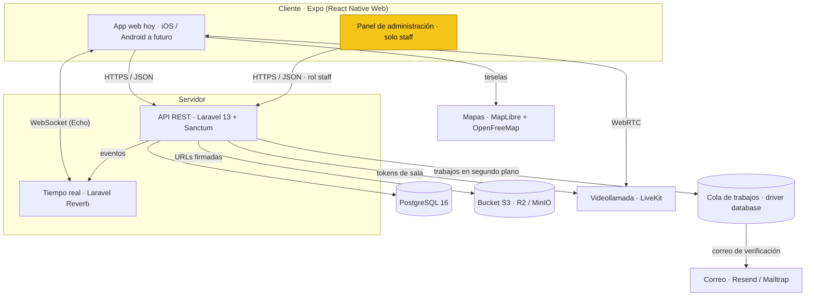

La caché, las sesiones y la cola usan el driver `database` de Laravel. Redis, que menciona el anteproyecto, se agregará solo si Reverb necesita varios servidores. La descripción de cada módulo está en [Arquitectura y tecnologías](#arquitectura-y-tecnologías), y la versión con módulos de la API y tabla de componentes está en [`docs/diagramas/arquitectura.md`](https://github.com/WilbertDevMx/backend-kampus/blob/develop/docs/diagramas/arquitectura.md) del backend. **[Nuevo]** Esa versión ya incluye los módulos **Roles y permisos** (T-40) y **Administración** (T-41 a T-43), en el [PR #13](https://github.com/WilbertDevMx/backend-kampus/pull/13).

#### Casos de uso

Diagrama en notación **UML**. Actores: **Visitante** (sin sesión), **Estudiante verificado**, que hereda los casos del Visitante, **[Nuevo]** **Moderador** (una universidad) y **Administrador** (todas), que hereda los casos del Moderador y además gestiona las cuentas de staff. **[Nuevo]** El staff ya no hereda del Estudiante, porque no usa las funciones sociales. También aparecen los sistemas externos **Servicio de correo** y **LiveKit**. Cada caso de uso indica su requisito, y las relaciones `include` y `extend` siguen la notación estándar. **[Nuevo]** Colores: amarillo = caso o actor nuevo; amarillo claro = caso modificado; gris = pasa a fase 2.

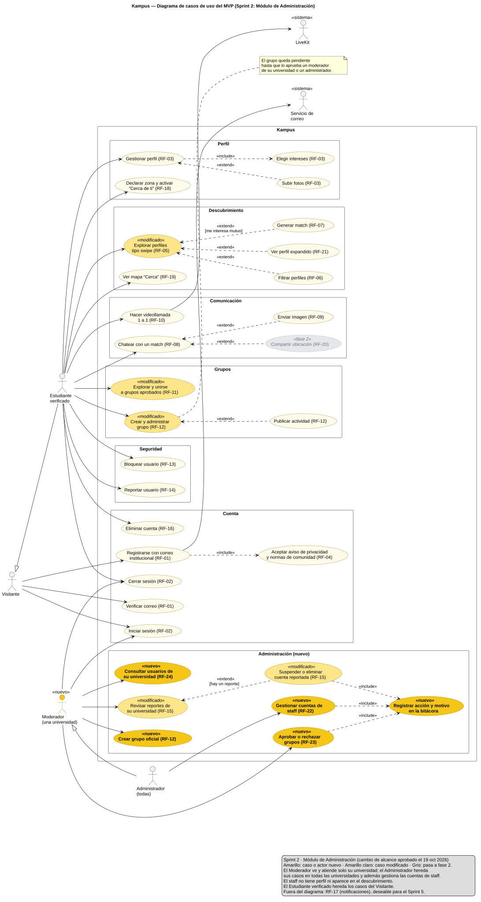

La fuente editable (PlantUML) está en `docs/diagramas/casos-de-uso.puml` del backend ([PR #9](https://github.com/WilbertDevMx/backend-kampus/pull/9); **[Nuevo]** versión con el módulo de Administración en el [PR #13](https://github.com/WilbertDevMx/backend-kampus/pull/13)). Si cambias el `.puml`, vuelve a generar el SVG y reemplázalo en `public/docs/project/unit-2/`.

| Caso de uso | Actor | Requisitos |
| --- | --- | --- |
| Registrarse con correo institucional (incluye verificar correo) | Visitante | RF-01, RF-04 |
| Iniciar / cerrar sesión | Estudiante, **[Nuevo]** Moderador, Administrador | RF-02 |
| Gestionar perfil y zona | Estudiante | RF-03, RF-18 |
| Descubrir perfiles (puede generar un match) **[Nuevo]** · solo entre estudiantes | Estudiante | RF-05, RF-06, RF-07, RF-21 |
| Ver mapa "Cerca" | Estudiante | RF-19 |
| Chatear con imágenes (**[Nuevo]** la ubicación pasa a fase 2) | Estudiante | RF-08, RF-09, RF-20 |
| Hacer videollamada 1 a 1 | Estudiante | RF-10 |
| Explorar **[Nuevo]** grupos aprobados, unirse y crear grupos **[Nuevo]** (quedan pendientes) | Estudiante | RF-11, RF-12 |
| Bloquear o reportar usuario | Estudiante | RF-13, RF-14 |
| Revisar reportes **[Nuevo]** de su universidad y suspender cuentas **[Nuevo]** reportadas (incluye registrar el motivo) | **[Nuevo]** Moderador, Administrador | RF-15 |
| **[Nuevo]** Consultar usuarios de su universidad | Moderador, Administrador | RF-24 |
| **[Nuevo]** Aprobar o rechazar grupos (incluye registrar el motivo) | Moderador, Administrador | RF-23 |
| **[Nuevo]** Crear grupo oficial | Moderador, Administrador | RF-12 |
| **[Nuevo]** Gestionar cuentas de staff (incluye registrar la acción) | Administrador | RF-22 |
| Eliminar cuenta | Estudiante | RF-16 |

#### Diagrama entidad-relación

Solo se muestran las tablas del dominio. El detalle de cada columna está en el [Diccionario de datos](#diccionario-de-datos). **[Nuevo]** Lo nuevo del módulo de Administración lleva el comentario `NUEVO S2`, y la tabla nueva `moderation_actions` va en amarillo.

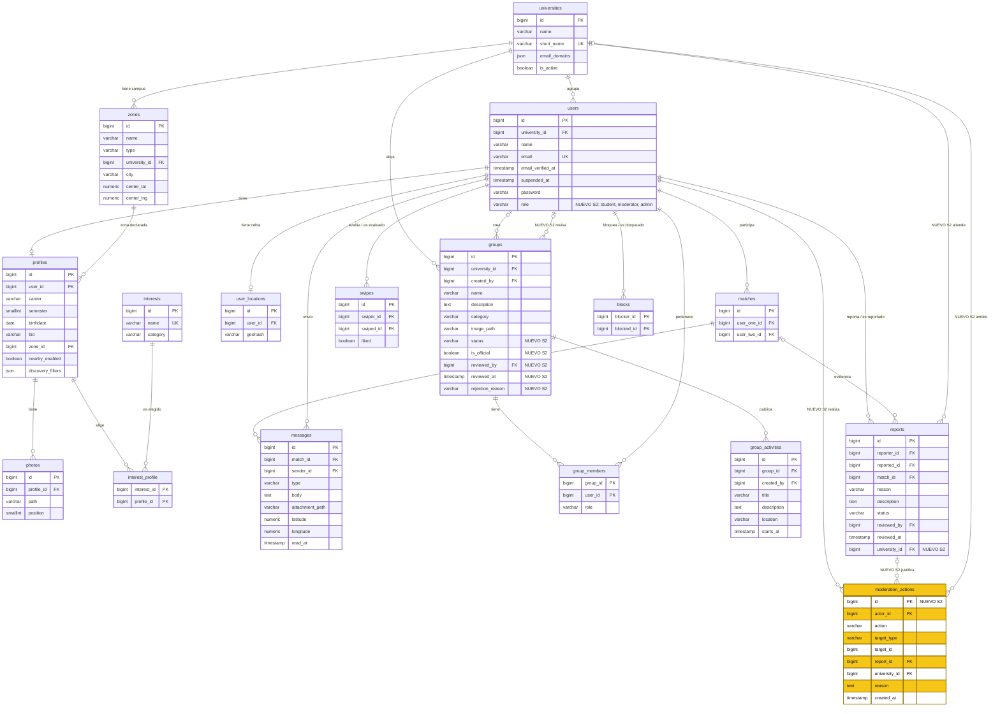

#### Secuencia: registro, verificación e inicio de sesión

Es el primer flujo del MVP (Sprint 1, tareas T-04 y T-05): cómo se crea una cuenta institucional y cómo se obtiene el token para usar la API.

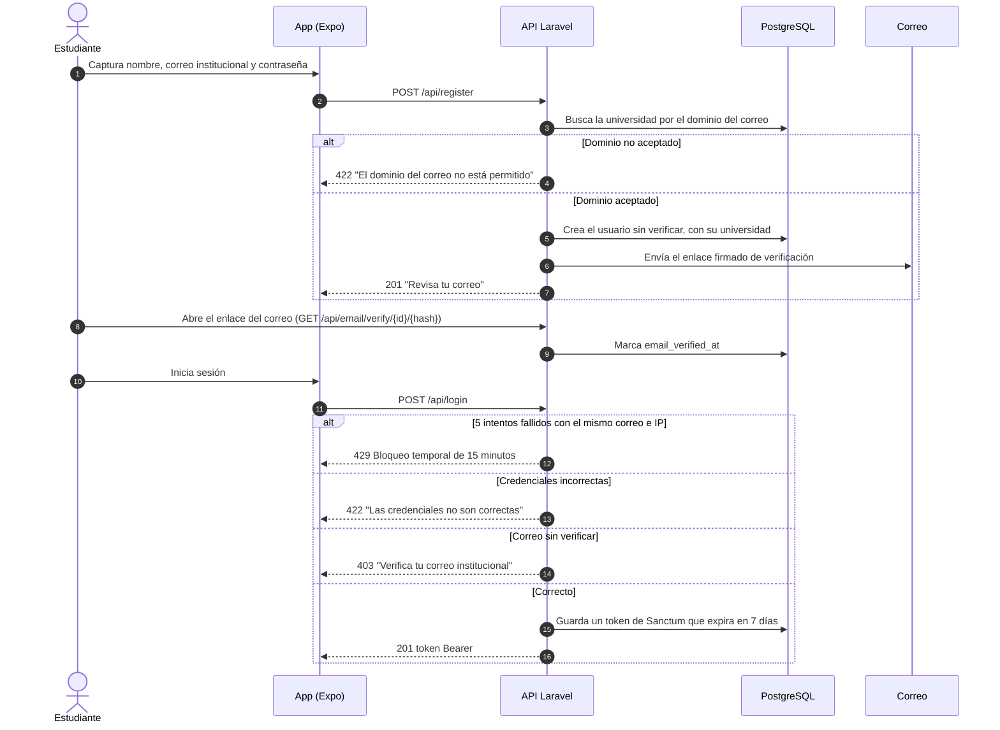

#### Secuencia: del swipe al match

Muestra cómo colaboran el cliente, la API y el servidor en tiempo real cuando dos estudiantes se dan "Me interesa" (patrón Observer, RF-07).

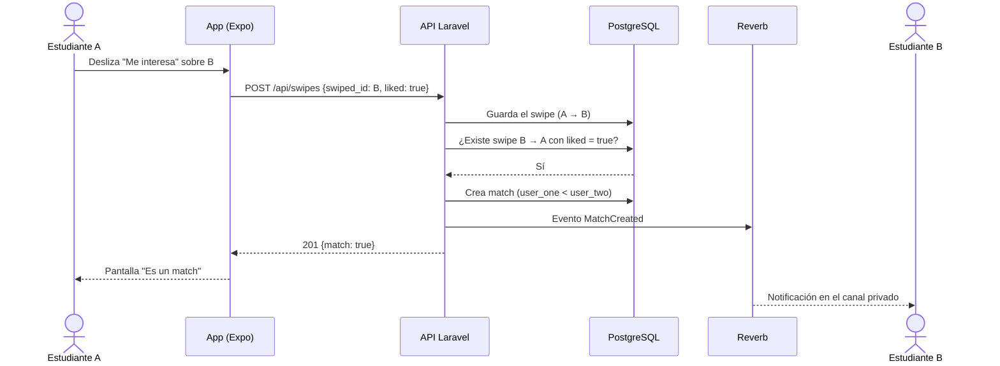

> [!NOTE]
> **Fuente del modelo de datos**
>
> El DER y el diccionario vienen de la especificación de la tarea T-02: `docs/base-de-datos/esquema.md` en `backend-kampus`, que entró a `develop` con el [PR #9](https://github.com/WilbertDevMx/backend-kampus/pull/9). **[Nuevo]** Los cambios del módulo de Administración están en el [PR #13](https://github.com/WilbertDevMx/backend-kampus/pull/13). Las migraciones de T-02 la implementan; cuando se integren a `develop`, ellas son la fuente de verdad y estos diagramas se actualizan en el mismo PR.

### Diccionario de datos

*Tablas, columnas, tipos, llaves, restricciones y descripción de cada campo.*

Modelo de datos del MVP de Kampus sobre **PostgreSQL 16**. Corresponde al [diagrama entidad-relación](#diagrama-entidad-relación) y a la tarea T-02 (RF-01 a RF-21). **[Nuevo]** Módulo de Administración: T-40 a T-43 (RF-22 a RF-24).

> [!NOTE]
> **Fuente**
>
> Especificación de `docs/base-de-datos/esquema.md` en `backend-kampus` (autores Wilbert y Mario), que entra a `develop` con el [PR #9](https://github.com/WilbertDevMx/backend-kampus/pull/9). Las migraciones de T-02 la implementan; cuando se integren a `develop`, ellas son la fuente de verdad: si una cambia, esta página se actualiza en el mismo PR.

> [!WARNING]
> **Nuevo · Sprint 2: Módulo de Administración**
>
> Se agregan los roles **moderador** (una sola universidad) y **administrador** (todas) en `users.role`, la **aprobación de grupos** en `groups`, la universidad que atiende cada reporte (`reports.university_id`) y la tabla nueva **`moderation_actions`**, una bitácora con motivo obligatorio. Fuente: [PR #13](https://github.com/WilbertDevMx/backend-kampus/pull/13) del backend ([cambio de alcance del 19 de octubre de 2026](#94-cambios-de-alcance)).

#### Convenciones

- Todas las tablas, salvo `interest_profile` y **[Nuevo]** `moderation_actions` (solo `created_at`), tienen `created_at` y `updated_at` (`timestamp`, nulos permitidos), que Laravel llena solo. No se repiten en cada tabla.
- **PK** = llave primaria · **FK** = llave foránea · **UK** = valor único.
- `bigint` autoincremental = `id()` de Laravel (secuencia de PostgreSQL).
- Las columnas de tipo `varchar` sin longitud indicada miden 255 caracteres.
- Al borrar el registro padre, cada FK hace una de tres cosas: **CASCADE** (borra también los hijos), **SET NULL** (deja la columna en nulo) o **RESTRICT** (impide el borrado).

#### Tablas

##### `universities` — Instituciones participantes

| Columna | Tipo | Nulo | Llave | Restricción / valor por defecto | Descripción |
|---|---|---|---|---|---|
| id | bigint | No | PK | Autoincremental | Identificador de la institución. |
| name | varchar(255) | No | | | Nombre oficial (p. ej. "Universidad Tecnológica de Torreón"). |
| short_name | varchar(20) | No | UK | | Siglas (UTT, UAdeC, ITL). |
| email_domains | json | No | | Arreglo de cadenas | Dominios de correo institucional aceptados en el registro (RF-01). |
| is_active | boolean | No | | `true` | Permite desactivar una institución sin borrarla. |

##### `users` — Cuentas de usuario

| Columna | Tipo | Nulo | Llave | Restricción / valor por defecto | Descripción |
|---|---|---|---|---|---|
| id | bigint | No | PK | Autoincremental | Identificador del usuario. |
| university_id | bigint | Sí | FK → universities.id | RESTRICT | Institución del alumno, deducida del dominio de su correo. **[Nuevo]** En un **moderador**, la universidad que modera (solo una); en un **administrador**, nulo. |
| name | varchar(255) | No | | | Nombre visible del alumno. |
| email | varchar(255) | No | UK | | Correo institucional; sirve para iniciar sesión. **[Nuevo]** Las cuentas de staff también usan correo institucional, del dominio de su universidad. |
| email_verified_at | timestamp | Sí | | | Fecha de verificación del correo. Mientras sea nulo la cuenta está inactiva (RF-01). |
| suspended_at | timestamp | Sí | | | Fecha de suspensión por moderación. Si tiene valor, la cuenta no puede iniciar sesión (RF-15). |
| password | varchar(255) | No | | Hash bcrypt | Contraseña cifrada (RNF-02). |
| role | varchar(20) | No | Índice | `'student'` | **[Nuevo]** Rol de la cuenta: `student`, `moderator` o `admin`. El registro público siempre crea `student`; solo un administrador crea moderadores y administradores (RF-22). El staff no tiene perfil ni aparece en el descubrimiento. |
| remember_token | varchar(100) | Sí | | | Token de "recordarme" de Laravel. |

##### `zones` — Catálogo de zonas (campus y colonias)

| Columna | Tipo | Nulo | Llave | Restricción / valor por defecto | Descripción |
|---|---|---|---|---|---|
| id | bigint | No | PK | Autoincremental | Identificador de la zona. |
| name | varchar(255) | No | UK compuesta (name, city) | | Nombre del campus o de la colonia. |
| type | varchar(20) | No | Índice | | Tipo de zona: `campus` o `colonia`. |
| university_id | bigint | Sí | FK → universities.id | SET NULL | Institución a la que pertenece el campus; nulo en colonias. |
| city | varchar(60) | No | UK compuesta (name, city) | | Ciudad (Torreón, Gómez Palacio, Lerdo…). |
| center_lat | numeric(9,6) | No | | | Latitud del centro de la zona. Es un punto público de referencia, no la ubicación de un usuario. |
| center_lng | numeric(9,6) | No | | | Longitud del centro de la zona. |

##### `profiles` — Perfil del alumno

| Columna | Tipo | Nulo | Llave | Restricción / valor por defecto | Descripción |
|---|---|---|---|---|---|
| id | bigint | No | PK | Autoincremental | Identificador del perfil. |
| user_id | bigint | No | FK → users.id, UK | CASCADE | Dueño del perfil. Un usuario tiene como máximo un perfil. |
| career | varchar(120) | Sí | | | Carrera o programa académico (RF-03). |
| semester | smallint | Sí | | 1 a 12, validado en la aplicación | Semestre o cuatrimestre actual. |
| birthdate | date | Sí | | | Fecha de nacimiento, para validar la mayoría de edad. |
| bio | varchar(300) | Sí | | Máx. 300 caracteres | "Sobre mí" (RF-03). |
| zone_id | bigint | Sí | FK → zones.id | SET NULL | Zona declarada: campus o colonia (RF-18). |
| nearby_enabled | boolean | No | | `false` | Indica si el alumno activó "Cerca de ti" (RF-18, RF-19). |
| discovery_filters | json | Sí | | | Filtros de descubrimiento guardados: universidades, carrera e intereses (RF-06). |

##### `user_locations` — Celda aproximada del alumno

| Columna | Tipo | Nulo | Llave | Restricción / valor por defecto | Descripción |
|---|---|---|---|---|---|
| id | bigint | No | PK | Autoincremental | Identificador del registro. |
| user_id | bigint | No | FK → users.id, UK | CASCADE | Alumno al que pertenece la celda. |
| geohash | varchar(6) | No | Índice | Precisión 6 (~1 km) | Celda geohash calculada en el navegador. **Nunca se guarda latitud ni longitud exactas** (RNF-11). |

Esta fila solo existe mientras "Cerca de ti" está activo. Al desactivarlo se borra.

##### `interests` — Catálogo de intereses

| Columna | Tipo | Nulo | Llave | Restricción / valor por defecto | Descripción |
|---|---|---|---|---|---|
| id | bigint | No | PK | Autoincremental | Identificador del interés. |
| name | varchar(60) | No | UK | | Nombre del interés (Fútbol, Programación, Anime…). |
| category | varchar(30) | No | | | Categoría: `deportes`, `cultura`, `entretenimiento`, `academico` o `social`. |

##### `interest_profile` — Intereses elegidos por cada perfil (tabla pivote)

| Columna | Tipo | Nulo | Llave | Restricción / valor por defecto | Descripción |
|---|---|---|---|---|---|
| interest_id | bigint | No | PK compuesta, FK → interests.id | CASCADE | Interés elegido. |
| profile_id | bigint | No | PK compuesta, FK → profiles.id | CASCADE | Perfil que lo eligió. Tiene índice propio para consultar los intereses de un perfil. |

RF-03 pide un mínimo de 3 intereses por perfil. Esa regla se valida en la aplicación.

##### `photos` — Fotos del perfil

| Columna | Tipo | Nulo | Llave | Restricción / valor por defecto | Descripción |
|---|---|---|---|---|---|
| id | bigint | No | PK | Autoincremental | Identificador de la foto. |
| profile_id | bigint | No | FK → profiles.id, UK compuesta (profile_id, position) | CASCADE | Perfil al que pertenece. |
| path | varchar(255) | No | | | Ruta del archivo en el bucket privado; se sirve con URL firmada temporal (RNF-03). |
| position | smallint | No | UK compuesta (profile_id, position) | 1 a 5, validado en la aplicación | Orden de la foto. La 1 es la principal. Máximo 5 fotos (RF-03). |

##### `swipes` — Evaluaciones de descubrimiento

| Columna | Tipo | Nulo | Llave | Restricción / valor por defecto | Descripción |
|---|---|---|---|---|---|
| id | bigint | No | PK | Autoincremental | Identificador del swipe. |
| swiper_id | bigint | No | FK → users.id, UK compuesta (swiper_id, swiped_id) | CASCADE | Quien evalúa. |
| swiped_id | bigint | No | FK → users.id, UK compuesta (swiper_id, swiped_id) | CASCADE | Quien es evaluado. |
| liked | boolean | No | Índice compuesto (swiped_id, liked) | | `true` = "Me interesa", `false` = "Pasar". |

El par único evita evaluar dos veces el mismo perfil (RF-05). El índice `(swiped_id, liked)` sirve para detectar el "me interesa" mutuo que genera un match (RF-07).

##### `matches` — Coincidencias mutuas

| Columna | Tipo | Nulo | Llave | Restricción / valor por defecto | Descripción |
|---|---|---|---|---|---|
| id | bigint | No | PK | Autoincremental | Identificador del match. |
| user_one_id | bigint | No | FK → users.id, UK compuesta (user_one_id, user_two_id) | CASCADE | El usuario con el **id menor** del par. |
| user_two_id | bigint | No | FK → users.id, UK compuesta (user_one_id, user_two_id); índice | CASCADE | El usuario con el **id mayor** del par. |

La aplicación siempre guarda el par ordenado (`user_one_id < user_two_id`). Así un mismo par no puede generar dos matches (RF-07).

##### `messages` — Mensajes del chat

| Columna | Tipo | Nulo | Llave | Restricción / valor por defecto | Descripción |
|---|---|---|---|---|---|
| id | bigint | No | PK | Autoincremental | Identificador del mensaje. También ordena la conversación. |
| match_id | bigint | No | FK → matches.id; índice compuesto (match_id, id) | CASCADE | Conversación a la que pertenece. Solo existe chat entre usuarios con match (RF-08). |
| sender_id | bigint | No | FK → users.id | CASCADE | Quien envía el mensaje. |
| type | varchar(20) | No | | `'text'` | Tipo de mensaje: `text`, `image` o `location`. |
| body | text | Sí | | | Texto del mensaje. Nulo en imágenes y ubicaciones. |
| attachment_path | varchar(255) | Sí | | | Ruta de la imagen en el bucket privado (RF-09). |
| latitude | numeric(9,6) | Sí | | Solo si `type = 'location'` | Latitud compartida a propósito por el emisor (RF-20). |
| longitude | numeric(9,6) | Sí | | Solo si `type = 'location'` | Longitud compartida a propósito por el emisor (RF-20). |
| read_at | timestamp | Sí | | | Fecha en que el receptor leyó el mensaje. |

`latitude` y `longitude` de esta tabla son el **único lugar** del sistema donde existe una coordenada exacta, y solo cuando el emisor confirmó que quiere compartirla. El índice `(match_id, id)` permite paginar el historial (RF-08).

##### `groups` — Grupos y clubes

| Columna | Tipo | Nulo | Llave | Restricción / valor por defecto | Descripción |
|---|---|---|---|---|---|
| id | bigint | No | PK | Autoincremental | Identificador del grupo. |
| university_id | bigint | Sí | FK → universities.id; índice compuesto (university_id, category) | SET NULL | Institución del grupo; nulo si es interinstitucional. |
| created_by | bigint | Sí | FK → users.id | SET NULL | Usuario que creó el grupo: un alumno o, **[Nuevo]** en grupos oficiales, un moderador o administrador. |
| name | varchar(255) | No | | | Nombre del grupo (RF-12). |
| description | text | Sí | | | Descripción del grupo. |
| category | varchar(20) | No | Índice compuesto (university_id, category) | | Categoría: `deportivo`, `cultural`, `academico` o `social` (RF-11). |
| image_path | varchar(255) | Sí | | | Ruta de la imagen del grupo en el bucket. |
| **[Nuevo]** status | varchar(20) | No | Índice compuesto (university_id, status) | `'pending'` | Estado de aprobación: `pending`, `approved` o `rejected`. Solo los grupos `approved` aparecen en la exploración (RF-23). |
| **[Nuevo]** is_official | boolean | No | | `false` | `true` si lo creó un moderador o administrador; esos grupos se aprueban automáticamente y llevan la insignia "Oficial". |
| **[Nuevo]** reviewed_by | bigint | Sí | FK → users.id | SET NULL | Moderador o administrador que aprobó o rechazó el grupo. |
| **[Nuevo]** reviewed_at | timestamp | Sí | | | Fecha de la aprobación o del rechazo. |
| **[Nuevo]** rejection_reason | varchar(300) | Sí | | Obligatorio si `status = 'rejected'` | Motivo del rechazo; se le muestra al creador. |

**[Nuevo]** Un grupo de un alumno queda en `pending` hasta que lo apruebe un moderador **de la misma universidad** o un administrador. Por ahora, editar un grupo ya aprobado **no** lo regresa a revisión.

##### `group_members` — Integrantes de cada grupo

| Columna | Tipo | Nulo | Llave | Restricción / valor por defecto | Descripción |
|---|---|---|---|---|---|
| group_id | bigint | No | PK compuesta, FK → groups.id | CASCADE | Grupo. |
| user_id | bigint | No | PK compuesta, FK → users.id; índice | CASCADE | Alumno integrante. |
| role | varchar(20) | No | | `'member'` | `admin` (puede publicar actividades y editar el grupo) o `member`. |

##### `group_activities` — Actividades publicadas por los grupos

| Columna | Tipo | Nulo | Llave | Restricción / valor por defecto | Descripción |
|---|---|---|---|---|---|
| id | bigint | No | PK | Autoincremental | Identificador de la actividad. |
| group_id | bigint | No | FK → groups.id; índice compuesto (group_id, starts_at) | CASCADE | Grupo que la publica. |
| created_by | bigint | Sí | FK → users.id | SET NULL | Administrador del grupo que la publicó. |
| title | varchar(255) | No | | | Título de la actividad (RF-12). |
| description | text | Sí | | | Descripción. |
| location | varchar(255) | Sí | | | Lugar en texto libre (p. ej. "Cancha 2, UTT"). |
| starts_at | timestamp | No | Índice compuesto (group_id, starts_at) | | Fecha y hora de inicio. |

##### `blocks` — Bloqueos entre usuarios

| Columna | Tipo | Nulo | Llave | Restricción / valor por defecto | Descripción |
|---|---|---|---|---|---|
| blocker_id | bigint | No | PK compuesta, FK → users.id | CASCADE | Quien bloquea. |
| blocked_id | bigint | No | PK compuesta, FK → users.id; índice | CASCADE | Quien es bloqueado. Desaparece del descubrimiento, los matches y el chat de ambos (RF-13). |

##### `reports` — Reportes de usuarios

| Columna | Tipo | Nulo | Llave | Restricción / valor por defecto | Descripción |
|---|---|---|---|---|---|
| id | bigint | No | PK | Autoincremental | Identificador del reporte. |
| reporter_id | bigint | Sí | FK → users.id | SET NULL | Quien reporta. Si elimina su cuenta, el reporte se conserva. |
| reported_id | bigint | No | FK → users.id | CASCADE | Usuario reportado. |
| match_id | bigint | Sí | FK → matches.id | SET NULL | Conversación que sirve como evidencia (RF-14). |
| reason | varchar(30) | No | | | Motivo del catálogo. Valores en [Catálogos de valores](#catálogos-de-valores). |
| description | text | Sí | | | Descripción opcional del reporte. |
| status | varchar(20) | No | Índice | `'pending'` | Estado del reporte en moderación (RF-15). |
| reviewed_by | bigint | Sí | FK → users.id | SET NULL | **[Nuevo]** Moderador o administrador que lo revisó. |
| reviewed_at | timestamp | Sí | | | Fecha de la revisión. |
| **[Nuevo]** university_id | bigint | No | FK → universities.id; índice compuesto (university_id, status) | RESTRICT | Universidad del **usuario reportado**. Define qué moderador atiende el reporte; el administrador ve todos. |

##### `moderation_actions` — Bitácora de moderación

Registro **inmutable** de cada acción del staff. No tiene `updated_at` y nunca se edita ni se borra.

| Columna | Tipo | Nulo | Llave | Restricción / valor por defecto | Descripción |
|---|---|---|---|---|---|
| id | bigint | No | PK | Autoincremental | Identificador de la acción. |
| actor_id | bigint | No | FK → users.id; índice | RESTRICT | Moderador o administrador que hizo la acción. Las cuentas de staff se **desactivan**, no se borran, para conservar la bitácora. |
| action | varchar(30) | No | Índice | | Tipo de acción. Valores en [Catálogos de valores](#catálogos-de-valores). |
| target_type | varchar(20) | No | Índice compuesto (target_type, target_id) | | Qué se afectó: `user`, `group` o `report`. |
| target_id | bigint | No | Índice compuesto (target_type, target_id) | | Id del usuario, grupo o reporte afectado. |
| report_id | bigint | Sí | FK → reports.id | SET NULL | Reporte que justifica la acción. **Obligatorio** cuando un moderador suspende o elimina una cuenta: no puede hacerlo sin un reporte. |
| university_id | bigint | Sí | FK → universities.id; índice compuesto (university_id, created_at) | SET NULL | Universidad en la que se hizo la acción; sirve para auditar a cada moderador. |
| reason | text | No | | Obligatorio | **Motivo** de la acción, escrito por quien la hace. |
| created_at | timestamp | No | | Fecha y hora del servidor | Momento de la acción. |


#### Catálogos de valores

PostgreSQL no restringe estos valores con `CHECK`. La aplicación los valida, idealmente con un `enum` de PHP por cada catálogo.

| Tabla.columna | Valores | Origen |
|---|---|---|
| users.role | **[Nuevo]** `student`, `moderator`, `admin` | RF-15, **[Nuevo]** RF-22 |
| zones.type | `campus`, `colonia` | RF-18 |
| interests.category | `deportes`, `cultura`, `entretenimiento`, `academico`, `social` | Anteproyecto, sección 15.1 |
| messages.type | `text`, `image`, `location` | RF-08, RF-09, RF-20 |
| groups.category | `deportivo`, `cultural`, `academico`, `social` | Anteproyecto, sección 15.1 |
| group_members.role | `admin`, `member` | RF-12 |
| reports.reason | `acoso`, `perfil_falso`, `contenido_inapropiado`, `spam`, `otro` | Anteproyecto, sección 15.1 |
| reports.status | `pending`, `reviewed`, `dismissed` | RF-15 |
| **[Nuevo]** groups.status | `pending`, `approved`, `rejected` | RF-23 |
| **[Nuevo]** moderation_actions.action | `suspend_user`, `reactivate_user`, `delete_user`, `approve_group`, `reject_group`, `create_staff`, `deactivate_staff`, `resolve_report`, `dismiss_report` | RF-15, RF-22, RF-23 |
| **[Nuevo]** moderation_actions.target_type | `user`, `group`, `report` | RF-15, RF-22, RF-23 |

**Datos iniciales.** `CatalogSeeder` debe sembrar las 3 instituciones con sus dominios y el catálogo de intereses, y poder ejecutarse varias veces sin duplicar nada (usando `upsert`). El catálogo de zonas (campus y colonias de la Comarca Lagunera) se siembra en T-28. **[Nuevo]** El **primer administrador** no se siembra con contraseña fija: se crea con el comando `php artisan kampus:create-admin` (T-40).


#### Tablas internas de Laravel

Existen en la base de datos, pero no forman parte del dominio:

| Tabla | Uso |
|---|---|
| `personal_access_tokens` | Tokens de Sanctum para la API, con expiración (RF-02). |
| `password_reset_tokens` | Tokens de recuperación de contraseña. |
| `sessions` | Sesiones de Laravel. |
| `cache`, `cache_locks` | Caché en base de datos; incluye el contador de intentos fallidos de inicio de sesión (RF-02). |
| `jobs`, `job_batches`, `failed_jobs` | Cola de trabajos, como el envío del correo de verificación. |


#### Trazabilidad con los requisitos

| Requisito | Tablas |
|---|---|
| RF-01 Registro con correo institucional | `universities`, `users` |
| RF-02 Inicio y cierre de sesión | `users`, `personal_access_tokens`, `cache` |
| RF-03 Gestión de perfil | `profiles`, `photos`, `interests`, `interest_profile` |
| RF-05 Descubrimiento tipo swipe | `swipes`, `profiles`; **[Nuevo]** excluye cuentas con `role` distinto de `student` |
| RF-06 Filtros de descubrimiento | `profiles.discovery_filters` |
| RF-07 Generación de match | `swipes`, `matches` |
| RF-08 / RF-09 Chat e imágenes | `messages` |
| RF-11 / RF-12 Grupos | `groups`, `group_members`, `group_activities`; **[Nuevo]** solo se listan grupos con `status = 'approved'` |
| RF-13 Bloqueo | `blocks` |
| RF-14 / RF-15 Reporte y moderación | `reports`, `users.suspended_at`, `users.role`; **[Nuevo]** `reports.university_id`, `moderation_actions` |
| RF-18 Zona del usuario | `zones`, `profiles.zone_id`, `profiles.nearby_enabled`, `user_locations` |
| RF-19 Vista "Cerca" | `zones`, `user_locations` |
| RF-20 Ubicación en el chat | `messages` (type `location`) |
| RF-21 Perfil expandible | `profiles`, `photos`, `interest_profile`, `group_members` |
| **[Nuevo]** RF-22 Gestión de cuentas de staff | `users.role`, `users.university_id`, `moderation_actions` (`create_staff`, `deactivate_staff`) |
| **[Nuevo]** RF-23 Aprobación de grupos | `groups.status`, `groups.is_official`, `groups.reviewed_by`, `groups.reviewed_at`, `groups.rejection_reason`, `moderation_actions` |
| **[Nuevo]** RF-24 Consulta de usuarios por universidad | `users.university_id`, `users.role` (el moderador solo ve los de su universidad) |
| RNF-11 Privacidad de ubicación | `user_locations.geohash`; ninguna otra tabla guarda coordenadas de usuarios |


#### Pendientes para revisar en equipo

1. **RF-04 (aceptación de aviso de privacidad y normas) no tiene dónde guardarse.** Propuesta: agregar a `users` las columnas `privacy_accepted_at` y `rules_accepted_at` (`timestamp`, nulo permitido). Así queda evidencia de cuándo aceptó cada documento.
2. **RF-16 (eliminación de cuenta en máximo 72 horas).** Los `CASCADE` ya borran perfil, fotos, swipes, matches, mensajes, bloqueos y membresías al borrar el usuario. Falta decidir si el borrado es inmediato o diferido. Si es diferido, hay que agregar `users.deletion_requested_at` y una tarea programada que borre la cuenta y los archivos del bucket.
3. **Dominios de correo duplicados.** El registro de T-04 (rama `garica`) valida contra `config('auth.allowed_email_domains')`, pero los dominios ya viven en `universities.email_domains`. Conviene validar contra la tabla y, al registrar, llenar `users.university_id`. Así hay una sola fuente de verdad.
4. **Nombre y apellido.** `users` tiene un solo campo `name`, y la pantalla de registro del frontend pide nombre y apellido por separado. Hay que acordar si se separan en dos columnas o si el frontend los une antes de enviarlos.
5. **RF-17 (notificaciones en la app)** es deseable y no tiene tabla. Si se implementa, la tabla `notifications` de Laravel (`php artisan make:notifications-table`) lo cubre sin diseño adicional.

### Prototipo y maquetado

*Del wireframe al prototipo navegable y a las pantallas construidas en Expo.*

#### Prototipo

> [!WARNING]
> **Nuevo · Sprint 2: Módulo de Administración**
>
> Se agregan las pantallas del **panel de administración**, pendientes de diseño, y su fila en el maquetado ([cambio de alcance del 19 de octubre de 2026](#94-cambios-de-alcance)).

El prototipo parte de los [wireframes](#wireframes) del anteproyecto (10 pantallas en móvil y 3 vistas de escritorio) y define el flujo de navegación, la distribución de cada pantalla y la experiencia de usuario.

| Entregable | Estado | Enlace |
| --- | :---: | --- |
| Wireframes móvil (360 × 740) y escritorio (1280 × 800) | ✅ | [Wireframes](#wireframes) |
| Wireframes editables (SVG) y guía de estilo | ✅ | [Archivos SVG](#archivos-editables) |
| Flujo de navegación | ✅ | [Flujo de navegación](#141-flujo-de-navegación) |
| Prototipo navegable en Figma | ✅ | [Abrir el prototipo](https://www.figma.com/proto/1l4aKYvdrpLcIa8OO8JcD2/Kampus-%E2%80%94-Prototipo?page-id=1%3A2&node-id=1-592&starting-point-node-id=1%3A592&scaling=min-zoom&content-scaling=fixed) (empieza en el inicio de sesión) |
| **[Nuevo]** Pantallas del panel de administración (A1 a A5) | 🟡 **Siguiente sprint · Sprint 3** | [Especificación](#143-pantallas-del-panel-de-administración-pendiente-de-diseño) |
| Archivo de diseño en Figma (pantallas, estilos y componentes) | ✅ | [Abrir el archivo](https://www.figma.com/design/1l4aKYvdrpLcIa8OO8JcD2/Kampus-%E2%80%94-Prototipo?node-id=1-2) |

##### Cómo armar el prototipo en Figma

1. **Crea el archivo.** En Figma: **Drafts → New design file**. Nómbralo `Kampus — Prototipo` y muévelo al proyecto del equipo para que todos puedan editarlo.
2. **Crea tres páginas** en el panel izquierdo: `Guía de estilo`, `Móvil` y `Escritorio`.
3. **Importa los SVG.** Descarga los [archivos editables](#archivos-editables) y arrástralos al lienzo: `00-guia-de-estilo` a su página, los `movil-*` a *Móvil* y los `escritorio-*` a *Escritorio*. Cada capa conserva su nombre (`Botón Iniciar sesión`, `Campo Correo institucional`, `Pestaña Chats`…), y los textos se pueden editar.
4. **Conviértelos en frames.** Si un SVG entra como grupo, selecciónalo y usa **Frame selection** (`Ctrl + Alt + G`). Ponle al frame el nombre de la pantalla (por ejemplo `01 Inicio de sesión`) y acomoda los frames en fila siguiendo el flujo.
5. **Fuente.** Los textos usan **Sora**, que ya viene en Figma (Google Fonts). Si aparece un aviso de fuente faltante, elige *Replace fonts → Sora*.
6. **Estilos y componentes (sistema de diseño).** En la guía de estilo, selecciona cada muestra de color y, en *Fill*, crea un estilo con su nombre (`accent`, `background`…). Haz lo mismo con los textos de la escala tipográfica. Convierte en componente (`Ctrl + Alt + K`) el botón, el campo, el chip, la tarjeta y la barra de navegación.
7. **Conecta las pantallas.** Cambia a la pestaña **Prototype** (`Shift + E`), selecciona la capa que se toca y arrastra el círculo azul hasta el frame destino. Usa *On tap → Navigate to* con *Smart animate* (300 ms). Las conexiones están en la tabla de abajo.
8. **Punto de inicio.** Selecciona el frame `01 Inicio de sesión` y, en el panel derecho, agrega un **Flow starting point** llamado `Flujo principal`. Para escritorio, crea otro desde `Escritorio 01`.
9. **Pruébalo** con **Present** (`Ctrl + Alt + Enter`) y recorre el flujo completo.
10. **Compártelo.** Da clic en **Share → Anyone with the link → can view → Copy link**. Pega el enlace en la tabla de arriba y cambia el estado a ✅.

###### Conexiones del prototipo

| Desde | Capa | Hacia |
| --- | --- | --- |
| 01 Inicio de sesión | `Botón Iniciar sesión` | 04 Descubrir — Para ti |
| 01 Inicio de sesión | texto `Regístrate` | 02 Registro |
| 02 Registro | `Botón Registrarse` | 03 Perfil (crear) |
| 03 Perfil | texto `Guardar` | 04 Descubrir — Para ti |
| 04 Descubrir — Para ti | `Tarjeta de perfil` (*On drag* hacia arriba) | 05 Perfil expandido |
| 04 Descubrir — Para ti | `Selector Para ti / Cerca` | 06 Descubrir — Cerca |
| 04 Descubrir — Para ti | `Botón Me interesa` | 07 Chats |
| 05 Perfil expandido | `Botón contraer` | 04 Descubrir — Para ti |
| 06 Descubrir — Cerca | `Botón Ver perfil` | 05 Perfil expandido |
| 07 Chats | `Conversación Ana` | 08 Conversación |
| 08 Conversación | `Botón videollamada` | 09 Videollamada |
| 09 Videollamada | `Colgar` | 08 Conversación |
| Cualquier pantalla con barra | `Pestaña Descubrir` · `Chats` · `Grupos` · `Perfil` | 04 · 07 · 10 · 03 |

> [!NOTE]
> **Atajo para la barra de navegación**
>
> Convierte la `Barra de navegación` en componente y conecta sus pestañas una sola vez dentro del componente: todas las pantallas que lo usen heredan las conexiones.

#### Maquetado

Las pantallas se construyen en Expo con Expo Router: cada archivo dentro de `src/app/` es una ruta, y la misma pantalla funciona en web y en móvil.

| Pantalla | Archivo | Requisito | Estado |
| --- | --- | --- | :---: |
| Inicio de sesión | `src/app/auth/login/index.tsx` | RF-02 | ✅ |
| Registro | `src/app/auth/register/index.tsx` | RF-01, RF-04 | ✅ |
| Revisa tu correo (verificación) | `src/components/auth/check-email-card.tsx` | RF-01 | ✅ |
| Recuperar contraseña | `src/app/auth/forgot-password/index.tsx` | RF-02 | ✅ |
| Aviso de privacidad | `src/app/legal/privacy.tsx` | RF-01 | ✅ |
| Normas de la comunidad | `src/app/legal/guidelines.tsx` | RF-01 | ✅ |
| Navegación principal (Descubrir, Chats, Grupos, Perfil) | `src/app/(tabs)/_layout.tsx` · `src/constants/navigation.ts` | RNF-01 | ✅ |
| Acceso solo con sesión (redirige al inicio de sesión) | `src/app/(tabs)/_layout.tsx` · `src/hooks/use-session.ts` | RF-02 | 🟡 Sesión en memoria hasta conectar la API (T-06) |
| Perfil (crear y editar) | `src/app/(tabs)/profile.tsx` | RF-03, RF-18 | 🟡 Estructura, menú y cerrar sesión; datos reales en T-08 |
| Descubrir y perfil expandido | `src/app/(tabs)/index.tsx` | RF-05, RF-06, RF-21 | 🟡 Selector *Para ti / Cerca* y estados vacíos; tarjetas en T-11 |
| Matches y chat | `src/app/(tabs)/chats.tsx` | RF-07, RF-08, RF-09 | 🟡 Estado vacío; conversaciones en T-12 y T-16 |
| Grupos | — | RF-11, RF-12 | ⬜ Sprint 4 |
| Vista "Cerca" | — | RF-19 | ⬜ Sprint 4 |
| Videollamada | — | RF-10 | ⬜ Sprint 4 |
| **[Nuevo]** Panel de administración (usuarios, reportes, grupos y staff) | — | RF-15, RF-22 a RF-24 | Pendiente · Sprint 4 |

##### Componentes base

| Componente | Archivo | Uso |
| --- | --- | --- |
| Botón | `src/components/ui/button.tsx` | Acciones primarias, secundarias y de menor peso |
| Campo de texto | `src/components/ui/text-field.tsx` | Formularios con etiqueta, ayuda y error |
| Casilla | `src/components/ui/checkbox.tsx` | Aceptar aviso de privacidad y normas |
| Tarjeta | `src/components/ui/card.tsx` | Agrupar contenido (perfiles, grupos, ajustes) |
| Chip | `src/components/ui/chip.tsx` | Intereses, categorías y filtros |
| Estado vacío | `src/components/ui/empty-state.tsx` | Listas sin contenido, con mensaje que orienta |
| Pantalla | `src/components/layout/screen.tsx` | Layout responsivo de las pantallas con pestañas |
| Navegación | `src/components/app-tabs.tsx` · `app-tabs.web.tsx` | Barra inferior en celular, barra lateral en escritorio |
| Logo | `src/components/kampus-logo.tsx` | Encabezado de acceso y barra lateral |
| Tema | `src/constants/theme.ts` | Colores, tipografía, espaciado y breakpoints de la marca |

Detalle de cada token y componente: [Sistema de diseño](https://doc.kodev.online/docs/mobile/design-system).

Cómo levantar la app: [Instalación](https://doc.kodev.online/docs/mobile/installation).

#### Criterios de calidad

- **Semántica y accesibilidad:** cada control tiene etiqueta accesible (`accessibilityLabel`), los títulos de pantalla usan `accessibilityRole="header"` (en web se renderizan como encabezados), contraste AA y tamaño táctil mínimo de 44 px (`MinTouchSize`, RNF-10).
- **Responsividad:** usable de 360 px a 1920 px sin desplazamiento horizontal (RNF-01). `use-breakpoint.ts` cambia la barra inferior por una barra lateral en escritorio.
- **Fidelidad al diseño:** colores, tipografía y espaciado del [sistema de marca](#152-imágenes-e-identidad-visual).

#### Capturas

Pantallas de la rama `develop` de la app, tomadas en web el 19 de octubre de 2026 con el tema oscuro por defecto. Las pestañas (Descubrir, Chats, Grupos y Perfil) se ven después de iniciar sesión.

##### Móvil (390 × 844)

| Inicio de sesión | Registro | Recuperar contraseña |
| --- | --- | --- |
| 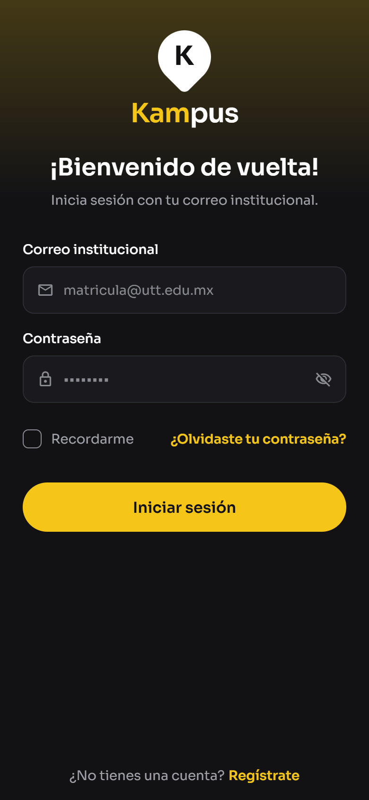 | 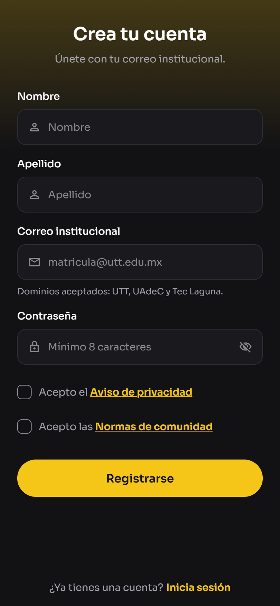 | 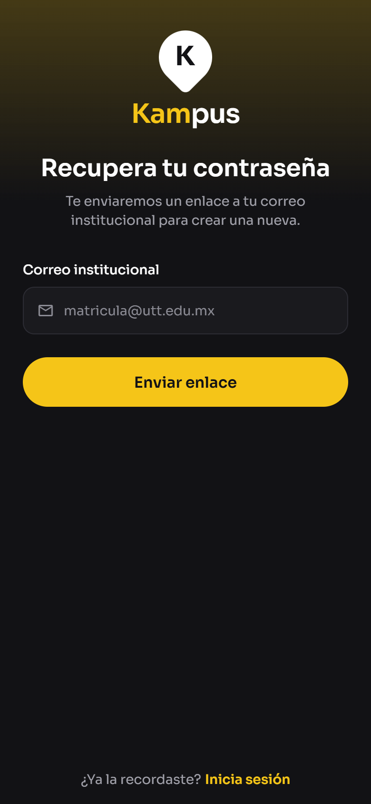 |
| Aviso de privacidad | Normas de la comunidad | Descubrir |
| 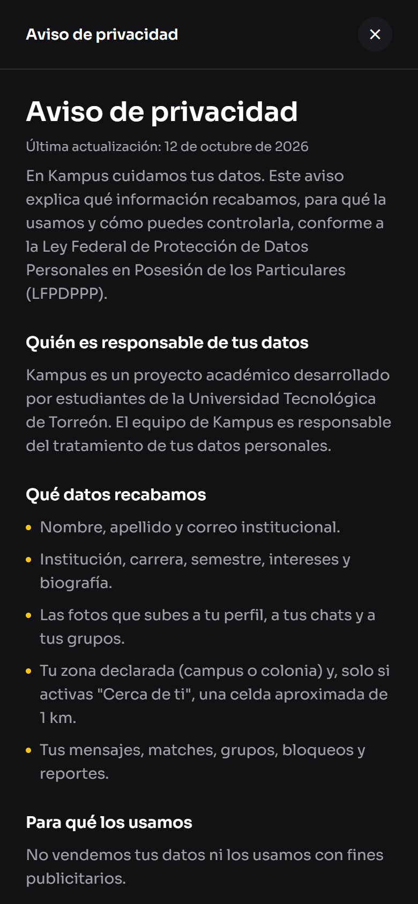 | 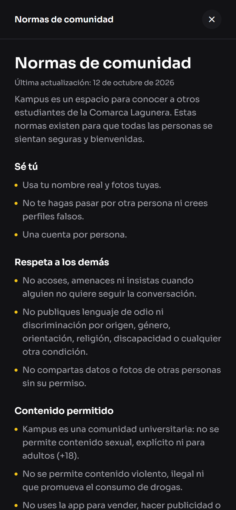 | 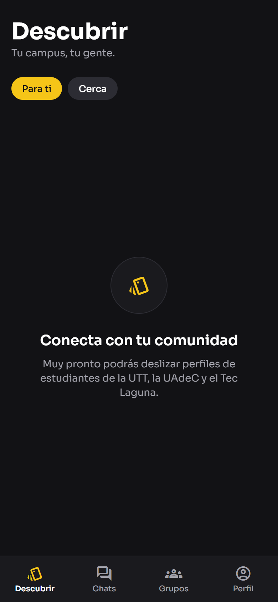 |
| Chats | Grupos | Perfil |
| 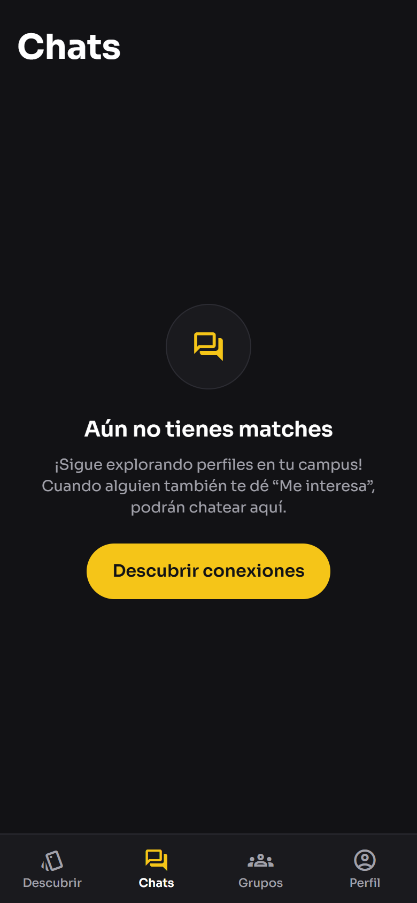 | 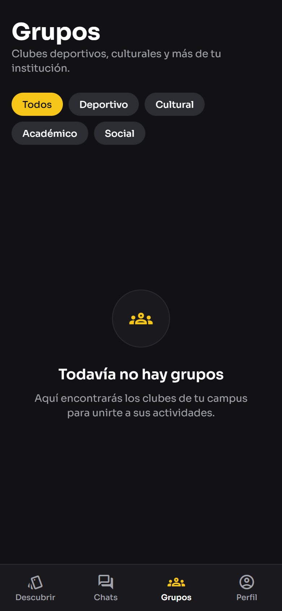 | 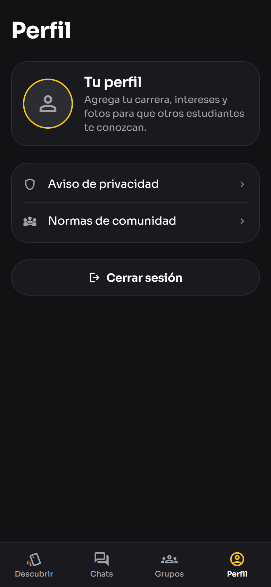 |

##### Escritorio (1280 × 800)

En escritorio la barra inferior se convierte en barra lateral.

| Inicio de sesión | Registro |
| --- | --- |
| 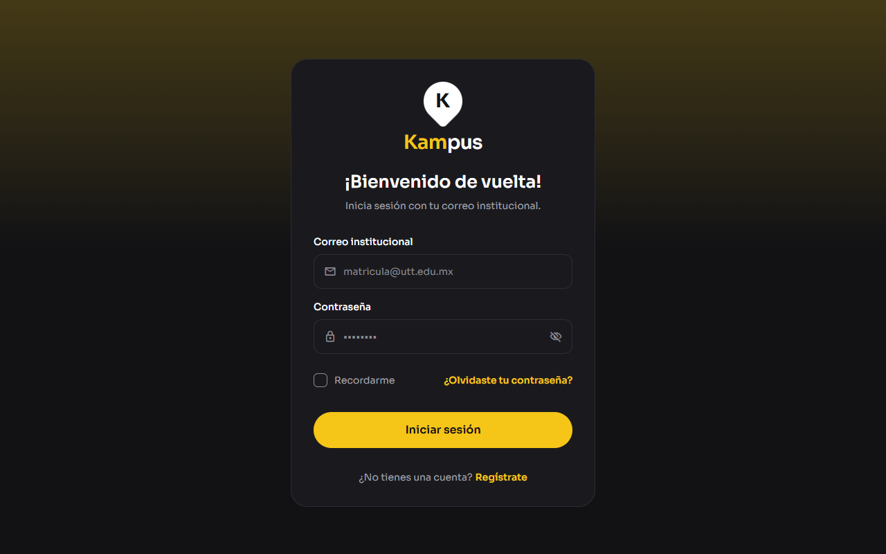 | 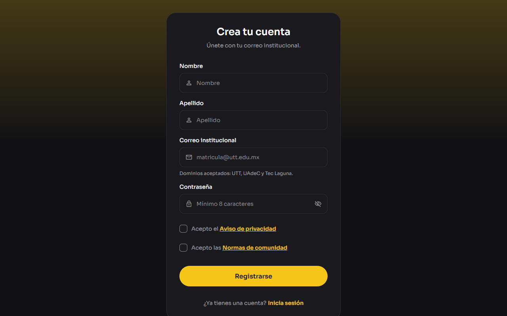 |
| Recuperar contraseña | Aviso de privacidad |
| 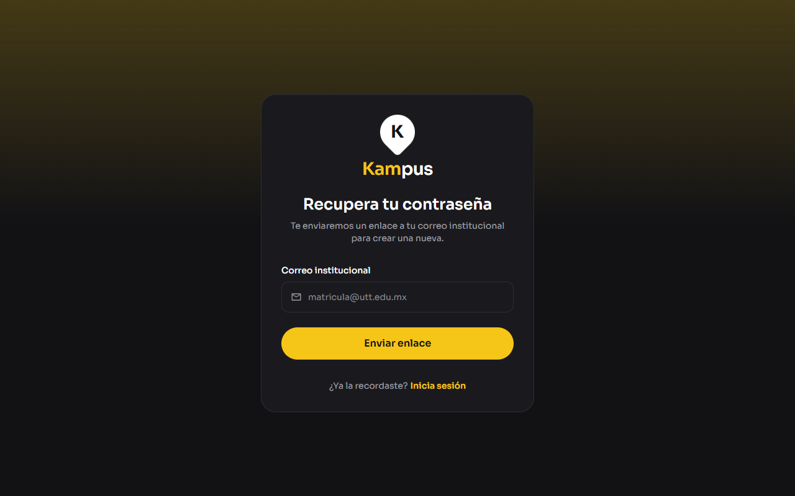 | 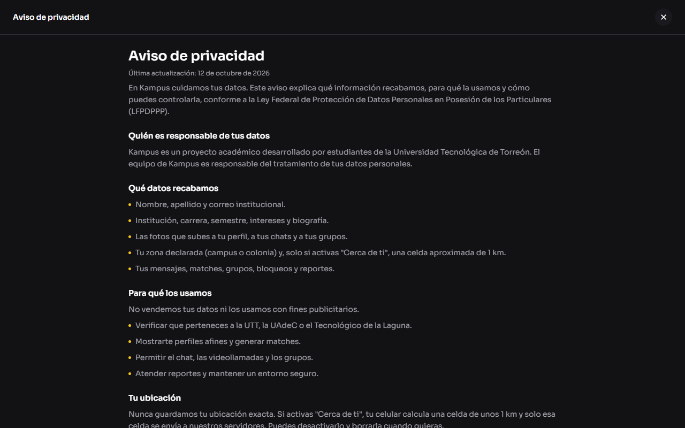 |
| Normas de la comunidad | Descubrir |
| 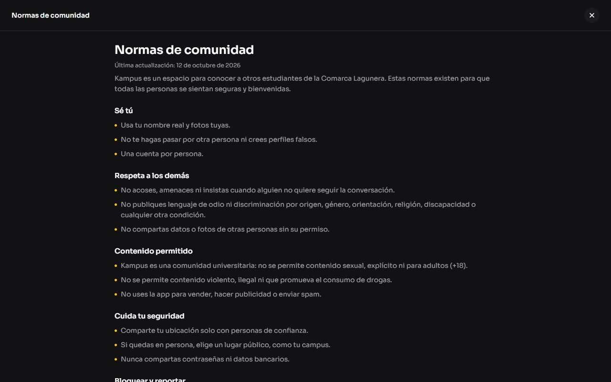 | 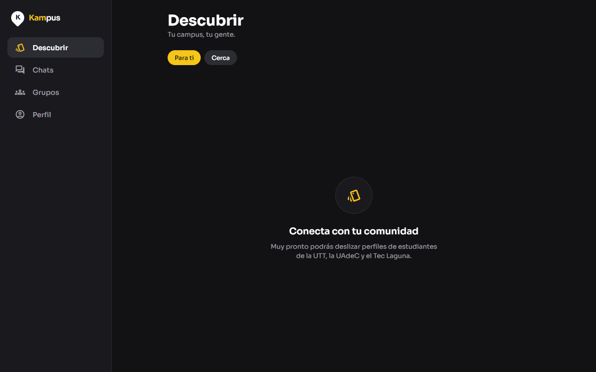 |
| Chats | Grupos |
| 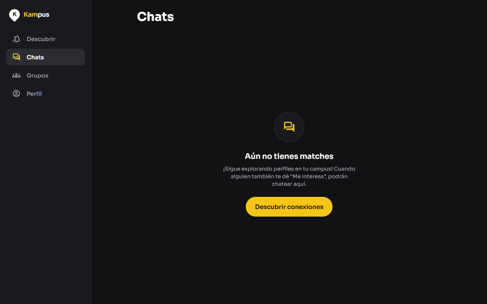 | 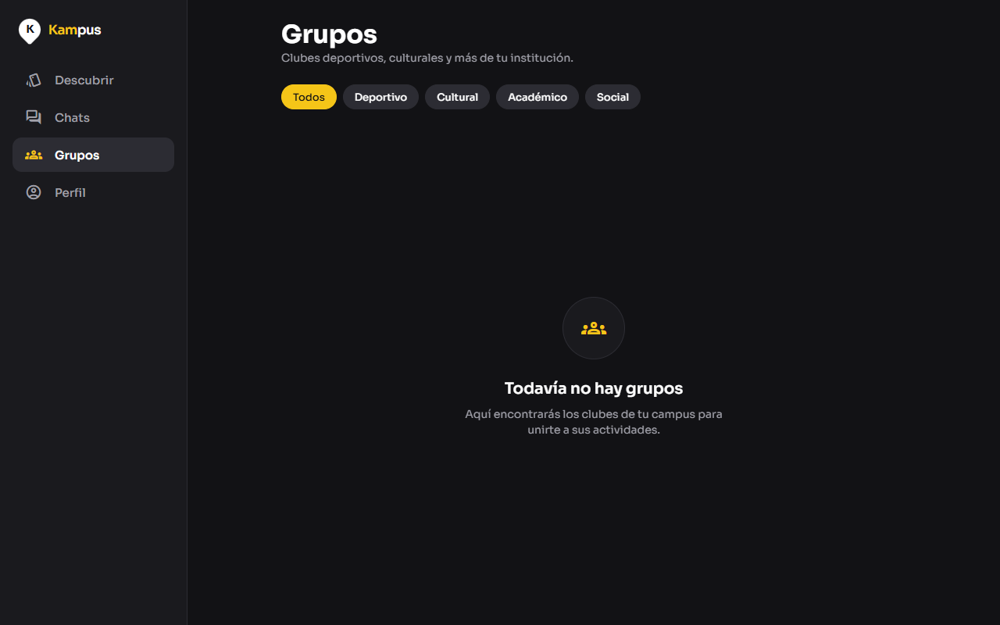 |
| Perfil | |
| 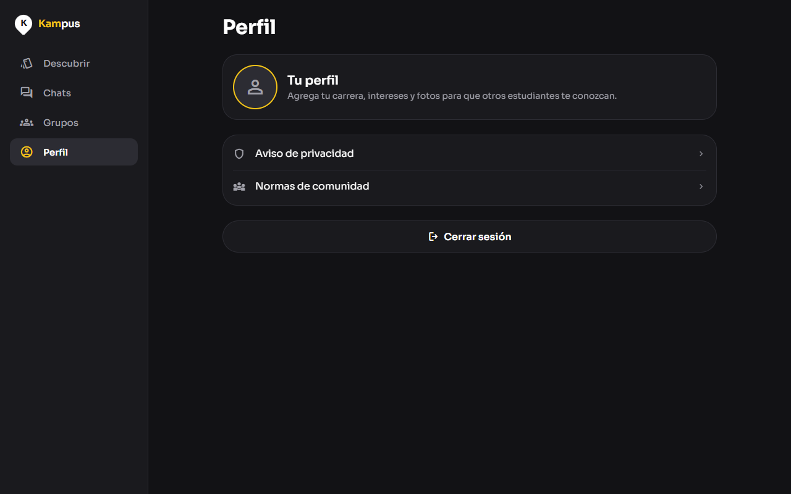 | |

---

## Sitio de documentación

El sitio está hecho con [Fumadocs](https://fumadocs.dev) (Next.js) y se publica como sitio estático. Es público, igual que los repositorios.

### Secciones del sitio

El menú lateral tiene un selector con cuatro secciones. `/docs` abre en **Proyecto**:

| Sección | Qué contiene | Carpeta |
| --- | --- | --- |
| **Proyecto** | El proyecto, privacidad de la ubicación (RNF-11) y la documentación formal: Unidad 1 (anteproyecto) y Unidad 2 | `content/docs/project/` |
| **Backend** | API REST con Laravel: instalación, configuración, comandos, CI y endpoints | `content/docs/backend/` |
| **App (Expo)** | Web y móvil con Expo y Expo Router: instalación, dispositivo, sistema de diseño y problemas comunes | `content/docs/mobile/` |
| **Desarrollo** | Flujo de Git, commits, pull requests, versiones y cómo documentar | `content/docs/development/` |

Además del contenido de `/docs`, el sitio tiene las páginas `/blog`, `/changelog` y `/team`.

### Documentación técnica

#### Backend (Laravel)

| Página | Archivo |
| --- | --- |
| Backend | [index.mdx](content/docs/backend/index.mdx) |
| Instalación | [installation.mdx](content/docs/backend/installation.mdx) |
| Configuración (variables de entorno) | [configuration.mdx](content/docs/backend/configuration.mdx) |
| Comandos útiles | [commands.mdx](content/docs/backend/commands.mdx) |
| Integración continua (GitHub Actions) | [continuous-integration.mdx](content/docs/backend/continuous-integration.mdx) |
| API REST · Introducción | [api/index.mdx](content/docs/backend/api/index.mdx) |
| API REST · Autenticación (Sanctum) | [api/authentication.mdx](content/docs/backend/api/authentication.mdx) |

#### App (Expo)

| Página | Archivo |
| --- | --- |
| App (Expo) | [index.mdx](content/docs/mobile/index.mdx) |
| Instalación | [installation.mdx](content/docs/mobile/installation.mdx) |
| Ver la app en tu celular | [device.mdx](content/docs/mobile/device.mdx) |
| Sistema de diseño (T-03) | [design-system.mdx](content/docs/mobile/design-system.mdx) |
| Solución de problemas | [troubleshooting.mdx](content/docs/mobile/troubleshooting.mdx) |

#### Desarrollo

| Página | Archivo |
| --- | --- |
| Desarrollo | [index.mdx](content/docs/development/index.mdx) |
| Flujo de Git | [git-workflow.mdx](content/docs/development/git-workflow.mdx) |
| Commits | [commits.mdx](content/docs/development/commits.mdx) |
| Pull requests | [pull-requests.mdx](content/docs/development/pull-requests.mdx) |
| Versiones y changelog | [releases.mdx](content/docs/development/releases.mdx) |
| Documentación (cómo agregar páginas) | [documentation.mdx](content/docs/development/documentation.mdx) |

### Desarrollo local

```bash
pnpm install
pnpm dev
```

Abre http://localhost:3000.

### Contenido

| Ruta | Qué contiene |
| --- | --- |
| `content/docs/` | Páginas de la documentación (una carpeta por sección) |
| `content/changelog.json` | Versiones publicadas (página `/changelog`) |
| `content/blog.json` + `content/blog/*.mdx` | Publicaciones del blog (página `/blog`) |
| `content/team.json` | Integrantes y lo que hace cada uno (página `/team`) |

Cada carpeta de `content/docs` con `"root": true` en su `meta.json` es una sección del selector del menú lateral. Los JSON tienen su esquema en `*.schema.json`. La guía completa está en la página **Desarrollo → Documentación**.

### Build y despliegue

```bash
pnpm build                      # genera el sitio estático en out/
```

El despliegue es automático: al publicar una versión en `main`, GitHub Actions (`.github/workflows/release.yml`) construye y publica el sitio en https://doc.kodev.online/. El proceso completo está en **Desarrollo → Versiones y changelog**.

### Código

| Ruta | Descripción |
| --- | --- |
| `src/app/(home)` | Inicio, blog, changelog y equipo |
| `src/app/docs` | Layout y páginas de la documentación |
| `src/app/api/search/route.ts` | Índice de búsqueda estático |
| `src/app/llms.txt`, `src/app/llms-full.txt`, `src/app/llms.mdx` | Versiones en texto de la documentación para LLMs |
| `src/app/og/docs` | Imágenes Open Graph de cada página |
| `src/lib/source.ts` | Colecciones de contenido (docs y blog) |
| `src/components/mermaid.tsx` | Diagramas Mermaid en las páginas |
| `src/components/risk-table.tsx` | Tabla del análisis de riesgos |
| `src/lib/changelog.ts`, `src/lib/blog.ts`, `src/lib/team.ts` | Lectura y validación de los JSON |
| `src/app/global.css` | Colores de la marca |
